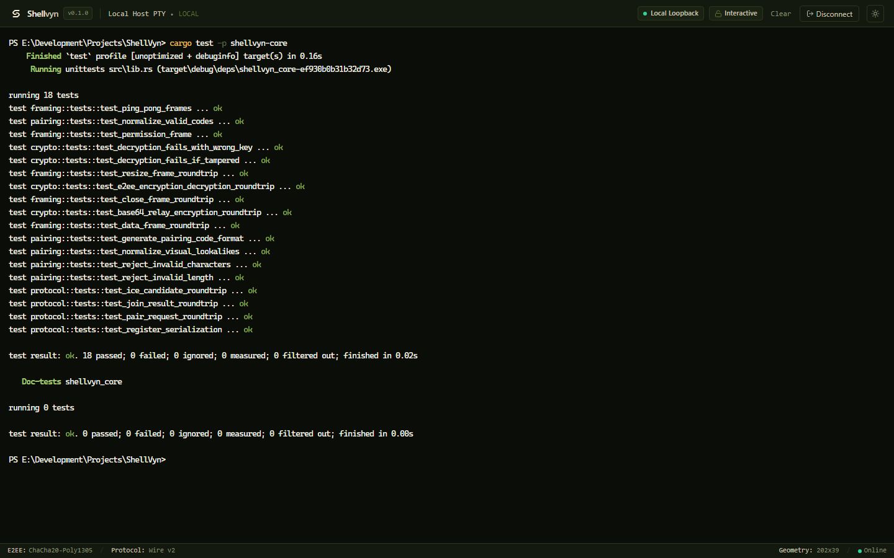
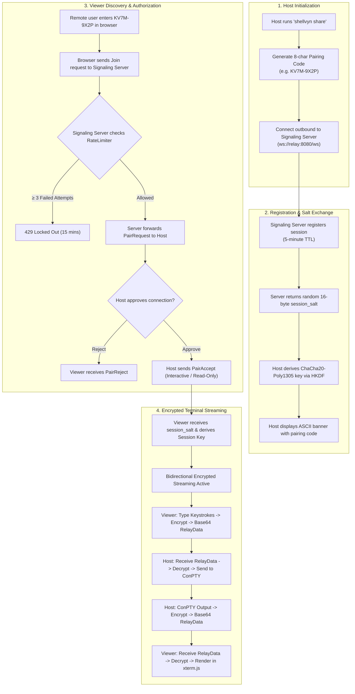
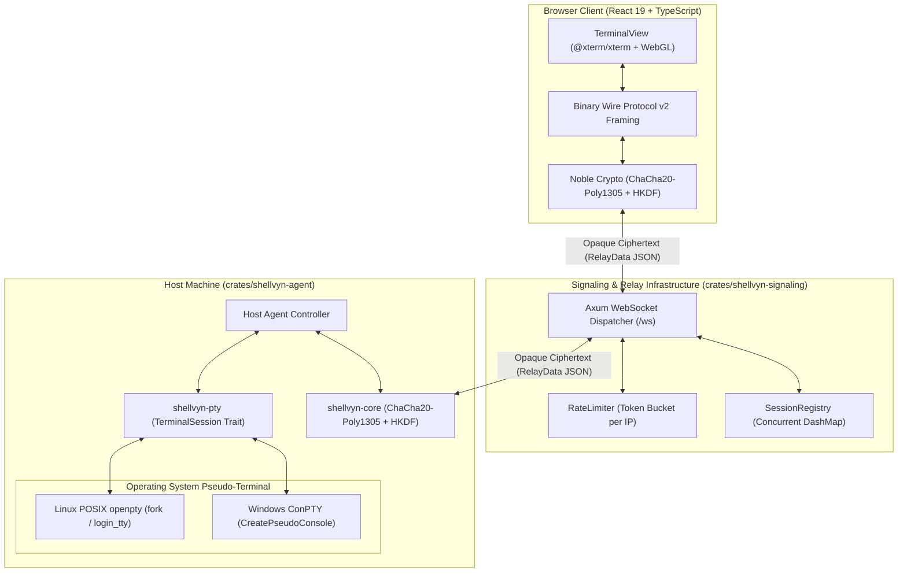
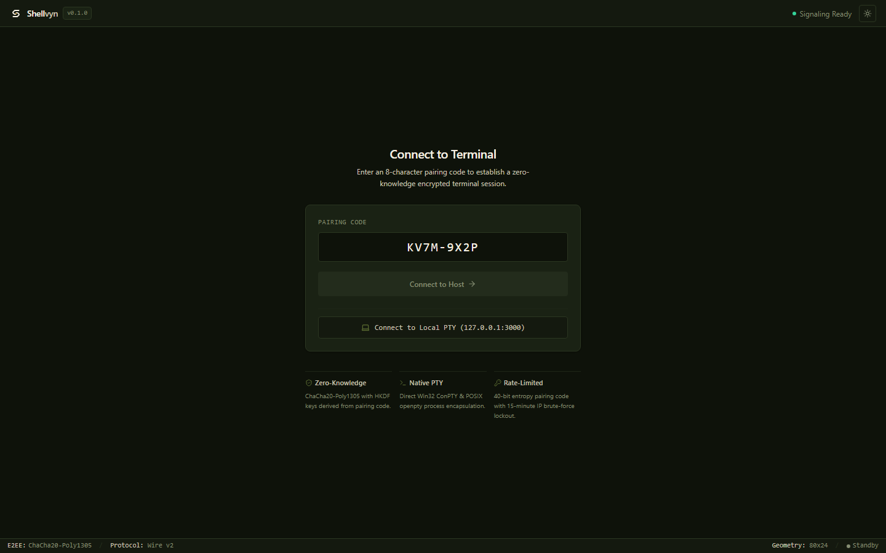

<div align="center">

  

  <p><strong>Your terminal. Anywhere.</strong></p>

  <p>
    An independent, zero-knowledge end-to-end encrypted terminal sharing platform for Windows and Linux.<br />
    No open ports. No public SSH keys. No cloud-relayed plaintext.
  </p>

  <p>
    <a href="https://github.com/reck98/Shellvyn/releases"></a>
    <a href="LICENSE-MIT"></a>
    <a href="https://www.rust-lang.org/"></a>
    
    
    <a href="TESTING_STATUS.md"></a>
    <a href="https://github.com/reck98/Shellvyn/stargazers"></a>
  </p>

  <br />

  

  <p align="center"><em>Live Shellvyn terminal sharing session in browser with Zero-Knowledge ChaCha20-Poly1305 encryption and native ConPTY streaming.</em></p>

</div>

---

## Table of Contents

- [What is Shellvyn?](#what-is-shellvyn)
  - [The Problem](#the-problem)
  - [The Shellvyn Solution](#the-shellvyn-solution)
  - [How Shellvyn Compares](#how-shellvyn-compares)
- [Key Features](#key-features)
- [How It Works](#how-it-works)
- [Architecture](#architecture)
  - [System Architecture](#system-architecture)
  - [Connection Establishment & Key Exchange](#connection-establishment--key-exchange)
  - [Terminal I/O Data Flow](#terminal-io-data-flow)
- [Technology Stack](#technology-stack)
- [Getting Started](#getting-started)
  - [Prerequisites](#prerequisites)
  - [Building from Source](#building-from-source)
  - [Diagnostic Self-Test](#diagnostic-self-test)
- [Usage Guide](#usage-guide)
  - [1. Remote Terminal Sharing (Primary Workflow)](#1-remote-terminal-sharing-primary-workflow)
  - [2. Local Loopback Mode (Direct Browser Testing)](#2-local-loopback-mode-direct-browser-testing)
  - [CLI Reference](#cli-reference)
- [Security Model](#security-model)
  - [Zero-Knowledge Confidentiality](#zero-knowledge-confidentiality)
  - [Brute-Force & Denial-of-Service Defense](#brute-force--denial-of-service-defense)
  - [Threat Mitigation Matrix](#threat-mitigation-matrix)
- [Repository Structure](#repository-structure)
- [Development & Verification](#development--verification)
  - [Running the Test Suites](#running-the-test-suites)
  - [Compiling Production Binaries](#compiling-production-binaries)
- [Roadmap](#roadmap)
- [Contributing](#contributing)
- [License](#license)
- [Acknowledgements](#acknowledgements)

---

## What is Shellvyn?

**Shellvyn** is an open-source, cross-platform terminal-sharing platform built in Rust and TypeScript. It enables developers, system administrators, and technical teams to instantly share terminal sessions directly to a web browser using an ephemeral 8-character pairing code (`XXXX-XXXX`).

### The Problem

Sharing or accessing a command-line environment remotely has traditionally forced engineers to make painful trade-offs:
- **SSH over the Internet**: Requires static public IPs, configuring NAT port forwarding on routers, managing firewalls, distributing authorized keys, and exposing port 22 to automated botnet scans.
- **Screen Sharing Tools (Zoom, TeamViewer, AnyDesk)**: Transmit multi-megabyte video frames, incur heavy CPU/GPU overhead, suffer from blurry text scaling, lack native terminal copy/paste, and cannot grant granular interactive vs. read-only permissions.
- **Third-Party Relay Daemons**: Many existing terminal-sharing tools pass raw terminal text through their intermediate cloud servers in plaintext, exposing proprietary source code, internal environment variables, and production credentials to relay operators.

### The Shellvyn Solution

Shellvyn replaces fragile tunneling and video-based screen shares with a **zero-knowledge terminal streaming protocol**:
1. **Zero Open Ports**: The host agent establishes an outbound connection to an ephemeral signaling relay. No router configuration or firewall changes are required.
2. **End-to-End Encrypted (E2EE)**: The host and viewer derive an identical 256-bit symmetric session key using HKDF-SHA256 from the pairing code. Terminal data is framed and encrypted with **ChaCha20-Poly1305 AEAD** before leaving the machine. The relay server routes opaque ciphertext and can never inspect keystrokes or terminal output.
3. **Native Terminal Fidelity**: Rather than capturing screen pixels, Shellvyn hooks directly into Windows ConPTY (`CreatePseudoConsole`) and Linux POSIX pseudo-terminals (`openpty`), transmitting pure UTF-8 ANSI byte streams rendered client-side by hardware-accelerated WebGL xterm.js.

### How Shellvyn Compares

| Feature | Traditional SSH | Screen Sharing (AnyDesk/Zoom) | Plaintext Web TTYs | **Shellvyn** |
| :--- | :---: | :---: | :---: | :---: |
| **Setup Complexity** | High (Ports, Keys, NAT) | Low | Medium | **Zero-Config (Instant)** |
| **Bandwidth Consumption** | Minimal (< 10 KB/s) | High (2–10 MB/s video) | Minimal (< 10 KB/s) | **Minimal (< 10 KB/s)** |
| **Client Requirement** | Local SSH Client | Heavy Native Client | Browser | **Modern Web Browser** |
| **Relay Confidentiality** | Direct Peer-to-Peer | Proprietary Cloud | Plaintext Server Relay | **Zero-Knowledge E2EE** |
| **Host Authorization** | Static Keys / Passwords | Manual Approval | URL Token | **Interactive Host Approval** |
| **Scope Control** | Full Shell Access | Full Desktop Control | Full Shell Access | **Interactive / Read-Only** |
| **Windows Native Support** | OpenSSH / WSL | Native App | Cygwin / WSL | **Native Win32 ConPTY** |

---

## Key Features

- **Zero-Knowledge E2EE**: Terminal streams are encrypted using **ChaCha20-Poly1305** authenticated encryption. Session keys are derived via **HKDF-SHA256** using the high-entropy pairing code and a cryptographic salt; intermediate relay servers process only opaque Base64-encoded ciphertext.
- **Native Windows ConPTY & Linux POSIX PTY**: Full platform parity. Windows builds utilize native Win32 `CreatePseudoConsole` APIs with clean subprocess encapsulation; Linux builds leverage POSIX `openpty`, `setsid`, and `ioctl(TIOCSWINSZ)`.
- **Hardware-Accelerated Web Terminal**: The browser client is powered by React 19 and `@xterm/xterm` with `@xterm/addon-webgl`, delivering 60 FPS rendering, full 24-bit true-color ANSI escape sequences, mouse event tracking, and seamless clipboard integration.
- **Crockford Base32 Ephemeral Pairing**: Sessions use 8-character codes (`XXXX-XXXX`, 40-bit entropy) generated via `rand::rngs::OsRng`. Visual lookalikes (`0`/`O` and `1`/`I`/`L`) are automatically normalized to eliminate user entry errors.
- **Brute-Force Rate Limiting**: The signaling service features a token-bucket rate limiter that enforces an immediate **15-minute IP lockout** upon 3 consecutive invalid code attempts. Unclaimed sessions auto-expire after a **5-minute (300s) TTL**.
- **Granular Session Permissions**: Hosts can designate sessions as **Interactive** (bidirectional keystrokes and window resizing) or **Read-Only** (remote keystrokes dropped at the host boundary).
- **Embedded Local Loopback Diagnostic**: An integrated loopback server (`shellvyn local`) allows testing terminal rendering directly in the browser on localhost without requiring signaling infrastructure.

---

## How It Works



---

## Architecture

Shellvyn is engineered as an isolated, modular system separating core protocol serialization, native terminal pseudo-console interfaces, WebSocket signaling routing, and browser rendering.

### System Architecture



### Connection Establishment & Key Exchange

```mermaid
sequenceDiagram
    autonumber
    actor Host as Host User
    participant Agent as Shellvyn Host Agent
    participant Relay as Signaling Relay Server
    participant Web as Shellvyn Web Client
    actor Viewer as Remote Viewer

    Host->>Agent: shellvyn share
    Agent->>Agent: Generate pairing code (KV7M-9X2P)
    Agent->>Relay: Register { version, code, hostname, os }
    Relay-->>Agent: Registered { status: "ok", session_salt, expires_in: 300 }
    Agent->>Agent: Derive Session Key = HKDF(code, session_salt)
    Agent-->>Host: Display Banner with Pairing Code & URL

    Viewer->>Web: Open https://shellvyn.reck98.in/#KV7M-9X2P
    Web->>Relay: Join { code: "KV7M-9X2P" }
    Relay->>Relay: Check IP rate limit (< 3 failures)
    Relay->>Agent: PairRequest { client_id, remote_ip, user_agent }
    Agent-->>Host: Prompt: Incoming request from remote_ip
    Agent->>Relay: PairAccept { client_id, permission: Interactive }
    Relay-->>Web: JoinResult { status: Connected, host_id, session_salt }
    Web->>Web: Derive Session Key = HKDF(code, session_salt)

    rect rgb(15, 23, 42)
        Note over Web,Agent: Zero-Knowledge E2EE Relay Channel Active (Relay cannot decrypt)
        Viewer->>Web: Keystroke (e.g. 'cargo build\n')
        Web->>Web: Encrypt Frame::Data with Session Key
        Web->>Relay: RelayData { from_id, target_id, payload: Base64(Ciphertext) }
        Relay->>Agent: RelayData { from_id, target_id, payload: Base64(Ciphertext) }
        Agent->>Agent: Decrypt Ciphertext with Session Key
        Agent->>Agent: Forward plaintext to ConPTY / POSIX PTY input
        Agent-->>Agent: PTY executes command & captures ANSI output
        Agent->>Agent: Encrypt Frame::Data with Session Key
        Agent->>Relay: RelayData { from_id, target_id, payload: Base64(Ciphertext) }
        Relay->>Web: RelayData { from_id, target_id, payload: Base64(Ciphertext) }
        Web->>Web: Decrypt Ciphertext with Session Key
        Web->>Web: Write bytes to xterm.js terminal buffer
        Web-->>Viewer: Render live terminal output
    end
```



### Terminal I/O Data Flow

Shellvyn uses a binary wire framing format (`v2`) inside encrypted AEAD envelopes:

```
┌──────────────┬───────────────────────────────┬──────────────────────────────┐
│ Opcode (1B)  │ Field Lengths (Optional)      │ Payload Body (Variable)      │
├──────────────┼───────────────────────────────┼──────────────────────────────┤
│ 0x01 (DATA)  │ N/A                           │ Raw UTF-8 / ANSI Byte Stream │
│ 0x02 (RESIZE)│ Cols (2B u16) + Rows (2B u16) │ Window Dimensions            │
│ 0x03 (CLOSE) │ N/A                           │ UTF-8 Disconnect Reason      │
│ 0x04 (PING)  │ N/A                           │ Keep-Alive Ping              │
│ 0x05 (PONG)  │ N/A                           │ Keep-Alive Pong              │
│ 0x06 (PERM)  │ Mode (1B: 0x00=RO, 0x01=RW)   │ Permission Scope State       │
└──────────────┴───────────────────────────────┴──────────────────────────────┘
```

---

## Technology Stack

| Component | Technology | Version | Purpose / Selection Rationale |
| :--- | :--- | :---: | :--- |
| **Language (Core/Host)** | [Rust](https://www.rust-lang.org/) | 1.80+ (2021 ed.) | Memory safety, zero-cost abstractions, deterministic subprocess control |
| **Language (Frontend)** | [TypeScript](https://www.typescriptlang.org/) | 5.7+ | Strict static typing matching Rust wire protocol definitions |
| **Frontend Framework** | [React](https://react.dev/) | 19.0+ | Reactive state machine managing session lifecycle and connection status |
| **Terminal Emulator** | [`@xterm/xterm`](https://xtermjs.org/) | 5.5+ | WebGL hardware-accelerated ANSI terminal rendering engine |
| **Signaling Server** | [Axum](https://github.com/tokio-rs/axum) / [Tokio](https://tokio.rs/) | 0.8 / 1.43 | High-throughput asynchronous WebSocket multiplexer |
| **Cryptography** | `chacha20poly1305` / `@noble/ciphers` | 0.10 / 1.2 | High-performance AEAD encryption without hardware AES acceleration dependencies |
| **Key Derivation** | `hkdf` + `sha2` / `@noble/hashes` | 0.12 / 1.7 | Cryptographically secure domain-separated key expansion |
| **Windows PTY** | `windows-sys` (Win32 ConPTY) | 0.59 | Native Windows 10/11 `CreatePseudoConsole` and `PROC_THREAD_ATTRIBUTE` APIs |
| **Linux PTY** | `nix` (POSIX `openpty`) | 0.29 | Standard POSIX terminal pseudo-device allocation, `login_tty`, and `setsid` |
| **Concurrent Registry** | [DashMap](https://github.com/xacrimon/dashmap) | 6.2 | Sharded concurrent hash map for non-blocking multi-tenant session routing |
| **CLI Parser** | [Clap](https://github.com/clap-rs/clap) | 4.5 | Declarative command-line argument parsing and help generation |
| **Build Tools** | Cargo & [Vite](https://vite.dev/) | Latest / 8.3 | Ultra-fast native Rust builds and optimized frontend bundling |

---

## Getting Started

### Quick Install (Host Agent)

To install the standalone `shellvyn` host agent directly without building from source:

**Windows (PowerShell):**
```powershell
irm https://raw.githubusercontent.com/reck98/Shellvyn/main/scripts/install-windows.ps1 | iex
```

**Linux & macOS (Bash / curl):**
```bash
curl -fsSL https://raw.githubusercontent.com/reck98/Shellvyn/main/scripts/install-linux.sh | bash
```

Once installed, share your terminal in one command:
```bash
shellvyn share
```

---

### Prerequisites (For Building from Source)

- **Rust**: Version 1.80 or later (`rustup default stable`).
  - *Windows*: Visual Studio C++ Build Tools or 64-bit MinGW toolchain.
  - *Linux*: `gcc`, `make`, `glibc-devel`.
- **Node.js**: Version 20.x or 22.x LTS and `npm`.

### Building from Source

1. **Clone the repository:**
   ```bash
   git clone https://github.com/reck98/Shellvyn.git
   cd Shellvyn
   ```

2. **Compile the Rust workspace (Host Agent & Signaling Server):**
   ```bash
   cargo build --release
   ```
   *Binaries are produced in `target/release/`:*
   - `shellvyn-agent` (`shellvyn-agent.exe` on Windows)
   - `shellvyn-signaling` (`shellvyn-signaling.exe` on Windows)

3. **Build the Web Client:**
   ```bash
   cd web
   npm install
   npm run build
   cd ..
   ```

### Diagnostic Self-Test

Before sharing over the network, execute the built-in diagnostic test to verify that the local pseudo-terminal (PTY) subsystem is functioning correctly on your machine:

```bash
# Test default operating system shell (PowerShell on Windows, bash on Linux)
./target/release/shellvyn-agent test-pty

# Or verify with a specific shell:
./target/release/shellvyn-agent test-pty --shell cmd
./target/release/shellvyn-agent test-pty --shell powershell
```

*Expected output:*
```text
== Shellvyn PTY Subsystem Self-Test ==
Spawning PTY with shell: PowerShell
[OK] PTY spawned in 27.6ms
[OK] Terminal I/O loopback roundtrip verified!
[OK] Resizing PTY to 120x40...
[OK] Terminal resized successfully.
PTY Subsystem Status: ALL TESTS PASSED.
```

---

## Usage Guide

### 1. Remote Terminal Sharing (Primary Workflow)

#### Step A: Start the Signaling Server
On a server accessible to both endpoints (or locally on `localhost` for testing):
```bash
./target/release/shellvyn-signaling --port 8080
```
*The signaling server listens on `ws://0.0.0.0:8080/ws` and exposes a health check at `http://0.0.0.0:8080/health`.*

#### Step B: Launch the Host Agent
On the machine whose terminal you want to share:
```bash
./target/release/shellvyn-agent share --server ws://127.0.0.1:8080/ws
```

The host agent registers with the signaling service and displays an active session banner:
```text
╔══════════════════════════════════════════════════════════════════════╗
║                    SHELLVYN HOST SESSION ACTIVE                      ║
╠══════════════════════════════════════════════════════════════════════╣
║  Pairing Code  : KV7M-9X2P                                           ║
║  Web Client    : https://shellvyn.reck98.in/#KV7M-9X2P                     ║
║  Host System   : WORKSTATION-01 (windows)                            ║
║  Session Mode  : Interactive                                         ║
║  Security      : Zero-Knowledge E2EE (ChaCha20-Poly1305 + HKDF)      ║
║  TTL (Expiry)  : 300 seconds                                         ║
╚══════════════════════════════════════════════════════════════════════╝

Status: Session registered. Waiting for incoming viewer connection...
```

#### Step C: Connect from the Web Client
1. Start the web frontend development server (`cd web && npm run dev`) or host the static build in `web/dist/`.
2. Open `http://localhost:5173` in any modern web browser.
3. Enter the 8-character pairing code (e.g., `KV7M-9X2P`).
4. Click **Connect to Host**.
5. Once connected, your browser terminal streams encrypted keystrokes and ANSI output in real time!

<p align="center">
  
</p>
<p align="center"><em>Shellvyn Web Client Lobby with ephemeral pairing code input and local PTY test bridge.</em></p>

---

### 2. Local Loopback Mode (Direct Browser Testing)

For offline presentations, testing terminal emulators, or local debugging, the host agent includes an embedded HTTP and WebSocket loopback server:

```bash
./target/release/shellvyn-agent local --port 3000
```
Then open `http://localhost:5173`, click **Direct Local Loopback**, and interact directly with your local machine's PTY without any signaling server.

---

### CLI Reference

#### `shellvyn-agent`

```text
Cross-platform secure terminal sharing host agent

Usage: shellvyn [COMMAND]

Commands:
  share     Share your current terminal session via the signaling server
  local     Run a local loopback server directly to browser for testing
  test-pty  Test pseudo-terminal (PTY) subsystem on this host
  help      Print this message or the help of the given subcommand(s)

Options:
  -h, --help     Print help
  -V, --version  Print version
```

**`shellvyn share` Options:**
- `--server <URL>`: WebSocket signaling server URL (default: `ws://127.0.0.1:8080/ws`).
- `--read-only`: Enable read-only mode (drops all remote keystrokes at the host agent).
- `--auto-accept <BOOL>`: Automatically approve incoming connection requests (default: `true`).
- `--shell <SHELL>`: Child shell to spawn: `powershell`, `cmd`, `bash`, or `default`.

---

## Security Model

Shellvyn is designed around zero-trust and defense-in-depth principles.

### Zero-Knowledge Confidentiality

- **Key Agreement**: Pairing secrets are never transmitted to the signaling server. The host and viewer derive session keys independently using HKDF-SHA256 with domain separation string `b"Shellvyn-E2EE-v2"`.
- **AEAD Encryption**: Every terminal data frame is encrypted with ChaCha20-Poly1305 using a cryptographically random 12-byte nonce generated via `rand::rngs::OsRng`. The 16-byte Poly1305 authentication tag guarantees integrity against tampering.
- **Relay Blindness**: The signaling relay server only routes JSON payloads with opaque Base64-encoded ciphertexts (`SignalingMessage::RelayData`). Even a compromised signaling server cannot read command outputs or inject synthetic keystrokes.

### Brute-Force & Denial-of-Service Defense

- **Entropy Space**: 8-character Crockford Base32 codes provide 40 bits of entropy ($32^8 \approx 1.1 \times 10^{12}$ combinations).
- **IP Rate Limiting**: The signaling server tracks failed join attempts in a thread-safe token bucket. If an IP submits **3 invalid codes**, it is locked out for **15 minutes**.
- **Ephemeral TTL**: Codes expire automatically after 300 seconds (5 minutes) if no viewer connects, eliminating stale session hijacking.

### Threat Mitigation Matrix

| Threat Vector | Severity | Mitigation in Shellvyn | Verification Status |
| :--- | :---: | :--- | :---: |
| **Relay Eavesdropping** | Critical | End-to-End ChaCha20-Poly1305 encryption. Relay only processes opaque ciphertext. | Verified (`e2ee_share_test.rs`) |
| **Code Brute-Force** | High | 40-bit entropy + 3-strike token-bucket rate limiter with 15m lockout + 5m TTL. | Verified (`signaling_test.rs`) |
| **Unauthorized Hijacking** | Critical | Mandatory host authorization handshake displaying remote IP and User-Agent. | Verified (`signaling_test.rs`) |
| **Rogue Remote Input** | High | Granular permission scoping: Host can enforce Read-Only mode to drop all remote input. | Verified (`framing.rs`) |
| **Handle / Descriptor Leaks** | Medium | Process handles wrapped in safe abstractions; Win32 inheritance flags disabled (`bInheritHandle=FALSE`). | Verified (`conpty.rs`) |
| **Replay Attacks** | High | Ephemeral pairing codes, unique session salts, and unique 12-byte random nonces per frame. | Verified (`crypto.rs`) |

---

## Repository Structure

```
Shellvyn/
├── architecture/               # Engineering specifications and protocol designs
│   ├── COMPONENT_DESIGN.md     # ConPTY, POSIX PTY, and component interfaces
│   ├── IMPLEMENTATION_ROADMAP.md # Phased milestone roadmap
│   ├── PROTOCOL_SPECIFICATION.md # Binary wire framing v2 and signaling specs
│   ├── SHELLVYN_ARCHITECTURE.md  # End-to-end architectural baseline
│   └── TECHNOLOGY_DECISIONS.md # Engineering trade-off documentation
├── crates/
│   ├── shellvyn-core/          # Protocol definitions, wire framing, crypto & pairing
│   │   ├── src/crypto.rs       # ChaCha20-Poly1305 AEAD & HKDF-SHA256 key derivation
│   │   ├── src/framing.rs      # Binary wire protocol v2 encode/decode
│   │   ├── src/pairing.rs      # Crockford Base32 generation and normalizer
│   │   └── src/protocol.rs     # Typed WebSocket signaling JSON messages
│   ├── shellvyn-pty/           # Native pseudo-terminal implementations
│   │   ├── src/conpty.rs       # Windows ConPTY (CreatePseudoConsole)
│   │   ├── src/posix.rs        # Linux POSIX PTY (openpty, fork, login_tty)
│   │   └── src/lib.rs          # Unified TerminalSession trait and factory
│   ├── shellvyn-signaling/     # Multi-tenant WebSocket signaling server
│   │   ├── src/rate_limit.rs   # Token-bucket rate limiter (IP lockout)
│   │   ├── src/registry.rs     # Ephemeral session registry with TTL eviction
│   │   ├── src/server.rs       # Axum WebSocket routing and message dispatch
│   │   └── tests/signaling_test.rs # Signaling integration test suite
│   └── shellvyn-agent/         # Native host CLI agent
│       ├── src/local.rs        # Local loopback HTTP & WebSocket server
│       ├── src/share.rs        # Remote sharing client and encrypted PTY streamer
│       ├── src/main.rs         # CLI entrypoint (`share`, `local`, `test-pty`)
│       └── tests/              # End-to-end integration tests (e2ee, loopback)
├── docs/                       # Project documentation assets
│   └── assets/
│       ├── logo/               # Vector branding and wordmarks
│       └── screenshots/        # High-resolution dashboard UI previews
├── web/                        # React 19 + TypeScript + Vite web client
│   ├── src/components/         # TerminalView (@xterm/xterm WebGL integration)
│   ├── src/protocol/           # TypeScript wire framing, crypto, and pairing
│   ├── src/App.tsx             # Lobby, pairing entry, active terminal view
│   └── package.json            # Web dependencies and build scripts
├── CHANGELOG.md                # Detailed release notes and milestone log
├── CONTRIBUTING.md             # Contributor onboarding and development guidelines
├── IMPLEMENTATION_STATUS.md    # Detailed milestone progress tracker
├── LICENSE-APACHE              # Apache 2.0 License
├── LICENSE-MIT                 # MIT License
├── SECURITY.md                 # Security policy, threat model, and reporting
└── TESTING_STATUS.md           # Automated test execution registers
```

---

## Development & Verification

### Running the Test Suites

Shellvyn maintains 100% automated test coverage across core cryptographic primitives, framing protocols, native PTY spawning, signaling handshakes, and end-to-end encrypted relay roundtrips:

```bash
# Run the entire workspace test suite
cargo test --workspace

# Run specific crate test suites
cargo test -p shellvyn-core
cargo test -p shellvyn-pty
cargo test -p shellvyn-signaling
cargo test -p shellvyn-agent

# Run the end-to-end zero-knowledge E2EE relay integration test
cargo test --test e2ee_share_test
```

### Compiling Production Binaries

```bash
# Compile optimized release binaries for the host agent and signaling server
cargo build --release

# Compile and bundle the web frontend
cd web && npm run build
```

---

## Roadmap

- [x] **M0: Project Foundation**: Workspace setup, protocol framing v2, Crockford Base32, ChaCha20-Poly1305 E2EE.
- [x] **M1: Native Terminal PTY**: Windows ConPTY subsystem, Linux POSIX openpty, process lifecycle, resize.
- [x] **M2: Web Client & Loopback**: React 19 + xterm.js WebGL terminal, local loopback server (`shellvyn local`).
- [x] **M3: Pairing & Signaling Service**: Axum WebSocket signaling, token-bucket rate limiter, 5m TTL registry.
- [x] **M4: Zero-Knowledge E2EE Relay**: End-to-end encrypted terminal streaming over relay, host agent (`shellvyn share`).
- [x] **M5: Security Hardening & Audit**: Rate-limit lockout verification, thread synchronization, memory safety.
- [x] **M6: Packaging & Release**: Optimized production binaries (`shellvyn-agent`, `shellvyn-signaling`), static web assets.
- [ ] **M7: Direct WebRTC DataChannel (Planned)**: Direct peer-to-peer WebRTC DataChannel transport with automatic fallback to zero-knowledge relay.
- [ ] **M8: Multi-Viewer Multiplexing (Planned)**: Support for multiple concurrent read-only spectators for collaborative debugging and classroom demonstrations.

---

## Contributing

We welcome contributions from the community! Please read our [Contributing Guidelines](CONTRIBUTING.md) and [Code of Conduct](CODE_OF_CONDUCT.md) before submitting pull requests.

To report a vulnerability, please consult our [Security Policy](SECURITY.md).

---

## License

Shellvyn is dual-licensed under either:

- **MIT License** ([LICENSE-MIT](LICENSE-MIT))
- **Apache License, Version 2.0** ([LICENSE-APACHE](LICENSE-APACHE))

at your option.

---

## Acknowledgements

Shellvyn is made possible by the open-source ecosystem:
- [xterm.js](https://xtermjs.org/) for the browser terminal emulator.
- [Tokio](https://tokio.rs/) and [Axum](https://github.com/tokio-rs/axum) for asynchronous runtime and networking.
- [RustCrypto](https://github.com/RustCrypto) and [Noble Cryptography](https://github.com/paulmillr/noble-ciphers) for ChaCha20-Poly1305 and HKDF implementations.
- The Microsoft Windows Terminal team for the Windows PseudoConsole (`ConPTY`) architecture.
