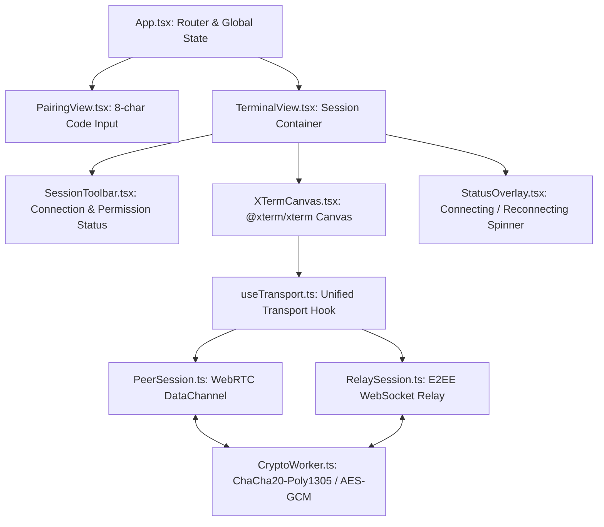

# Component Design: Shellvyn Host, Web Client, and Services

## 1. Rust Host Agent Component Design

The Shellvyn Host Agent is an asynchronous, multi-threaded binary written in Rust using `tokio`. It follows an actor-oriented pattern with asynchronous message-passing channels (`tokio::sync::mpsc`).

```mermaid
graph TD
    subgraph Host_Agent_Internals
        MAIN[Main Supervisor Task]
        TUI[Ratatui TUI Task]
        SIG_TASK[Signaling Actor]
        RTC_TASK[WebRTC Actor (webrtc-rs)]
        RELAY_TASK[Relay Actor]
        TERM_ACTOR[Terminal Process Actor]
        
        MAIN <-->|mpsc Event Bus| SIG_TASK
        MAIN <-->|mpsc Event Bus| RTC_TASK
        MAIN <-->|mpsc Event Bus| RELAY_TASK
        MAIN <-->|mpsc Event Bus| TERM_ACTOR
        MAIN <-->|mpsc State Sync| TUI
    end
    
    subgraph OS_Execution
        TERM_ACTOR -->|ConPTY / Win32| WIN_CHILD[PowerShell Process]
        TERM_ACTOR -->|POSIX PTY / termios| LIN_CHILD[Bash Process]
    end
```

### 1.1 Terminal Process Manager (`TerminalManager` Trait)

```rust
use async_trait::async_trait;
use std::io::Result;
use tokio::io::{AsyncRead, AsyncWrite};

#[derive(Debug, Clone, Copy)]
pub struct Winsize {
    pub cols: u16,
    pub rows: u16,
}

#[async_trait]
pub trait TerminalManager: Send + Sync {
    /// Spawns the default shell connected to an isolated pseudo-terminal.
    async fn spawn(&mut self, initial_size: Winsize) -> Result<()>;
    
    /// Resizes the pseudo-terminal window.
    async fn resize(&mut self, size: Winsize) -> Result<()>;
    
    /// Asynchronously writes user keystrokes into the shell's input stream.
    async fn write_input(&mut self, data: &[u8]) -> Result<()>;
    
    /// Reads terminal output from the shell's output stream.
    async fn read_output(&mut self, buffer: &mut [u8]) -> Result<usize>;
    
    /// Gracefully terminates the shell and child process tree.
    async fn terminate(&mut self) -> Result<()>;
}
```

### 1.2 Windows ConPTY Implementation (`ConPtyManager`)
*Targeting Windows 10 (Build 1809+) and Windows 11*

```rust
#[cfg(windows)]
pub struct ConPtyManager {
    h_pc: windows_sys::Win32::System::Console::HPCON,
    stdin_write: tokio::fs::File,
    stdout_read: tokio::fs::File,
    process_handle: windows_sys::Win32::Foundation::HANDLE,
}

#[cfg(windows)]
impl ConPtyManager {
    pub async fn new(initial_size: Winsize) -> std::io::Result<Self> {
        use windows_sys::Win32::System::Console::*;
        use windows_sys::Win32::System::Threading::*;
        
        // 1. Create communication pipes
        let (in_read, in_write) = create_pipe_pair()?;
        let (out_read, out_write) = create_pipe_pair()?;
        
        // 2. Initialize ConPTY pseudo console
        let mut h_pc = 0;
        let coord = COORD {
            X: initial_size.cols as i16,
            Y: initial_size.rows as i16,
        };
        let hr = unsafe {
            CreatePseudoConsole(coord, in_read, out_write, 0, &mut h_pc)
        };
        if hr != 0 {
            return Err(std::io::Error::from_raw_os_error(hr));
        }
        
        // 3. Configure PROC_THREAD_ATTRIBUTE_PSEUDOCONSOLE
        let process_handle = spawn_process_with_pseudoconsole(h_pc)?;
        
        Ok(Self {
            h_pc,
            stdin_write: in_write,
            stdout_read: out_read,
            process_handle,
        })
    }

    pub async fn resize(&mut self, size: Winsize) -> std::io::Result<()> {
        use windows_sys::Win32::System::Console::*;
        let coord = COORD {
            X: size.cols as i16,
            Y: size.rows as i16,
        };
        let hr = unsafe { ResizePseudoConsole(self.h_pc, coord) };
        if hr != 0 {
            return Err(std::io::Error::from_raw_os_error(hr));
        }
        Ok(())
    }
}
```

### 1.3 Linux POSIX PTY Implementation (`PosixPtyManager`)
*Targeting Linux POSIX compliant distros*

```rust
#[cfg(unix)]
pub struct PosixPtyManager {
    master_fd: std::os::unix::io::OwnedFd,
    child_pid: nix::unistd::Pid,
    master_file: tokio::fs::File,
}

#[cfg(unix)]
impl PosixPtyManager {
    pub async fn new(initial_size: Winsize) -> std::io::Result<Self> {
        use nix::pty::openpty;
        use nix::sys::termios;
        
        let ws = nix::pty::Winsize {
            ws_row: initial_size.rows,
            ws_col: initial_size.cols,
            ws_xpixel: 0,
            ws_ypixel: 0,
        };
        
        let pty_pair = openpty(&ws, None).map_err(|e| std::io::Error::new(std::io::ErrorKind::Other, e))?;
        
        // Fork child process and bind slave_fd to stdin, stdout, stderr via login_tty
        let child_pid = spawn_child_shell(pty_pair.slave)?;
        
        let master_file = tokio::fs::File::from_std(unsafe {
            std::fs::File::from_raw_fd(pty_pair.master.as_raw_fd())
        });
        
        Ok(Self {
            master_fd: pty_pair.master,
            child_pid,
            master_file,
        })
    }

    pub async fn resize(&mut self, size: Winsize) -> std::io::Result<()> {
        use nix::sys::ioctl;
        let ws = nix::pty::Winsize {
            ws_row: size.rows,
            ws_col: size.cols,
            ws_xpixel: 0,
            ws_ypixel: 0,
        };
        unsafe {
            // ioctl(fd, TIOCSWINSZ, &ws) triggers SIGWINCH to the shell
            nix::libc::ioctl(self.master_fd.as_raw_fd(), nix::libc::TIOCSWINSZ, &ws);
        }
        Ok(())
    }
}
```

---

## 2. Shellvyn Web Client Component Design

The web frontend is structured into modular React components with strict separation between terminal presentation, transport abstraction, and signaling.



### 2.1 Unified Transport Interface (`ITransportSession`)

```typescript
export interface TransportEvent {
  type: "connected" | "disconnected" | "data" | "error";
  data?: Uint8Array;
  error?: string;
  reason?: string;
}

export interface ITransportSession {
  connect(): Promise<void>;
  sendData(data: string | Uint8Array): void;
  sendResize(cols: number, rows: number): void;
  disconnect(reason?: string): void;
  onEvent(callback: (event: TransportEvent) => void): () => void;
}
```

### 2.2 XTermCanvas Integration
- **WebGL Acceleration**: Uses `@xterm/addon-webgl` for 60fps hardware-accelerated terminal rendering.
- **Dynamic Fit**: Uses `@xterm/addon-fit` tied to a `ResizeObserver` on the parent container. Debounced to 50ms to avoid saturating the network with resize events.
- **Color Theme**: True-color (24-bit ANSI) theme with high-contrast accessibility compliance.

---

## 3. Signaling & Relay Service Component Design

Built on Rust `axum` and `tokio-tungstenite`:
- **State Store (`DashMap<String, SessionRoom>`)**: Lock-free concurrent hash map tracking active host registrations and pending pairing requests.
- **Session Expiry Watchdog**: Background cron task scanning for stale codes older than 5 minutes and pruning inactive rooms.
- **Token Bucket Rate Limiter**: Per-IP struct tracking request tokens; replenishes at 1 token / 30 seconds; burst size of 3. Blocks brute-force enumeration.
