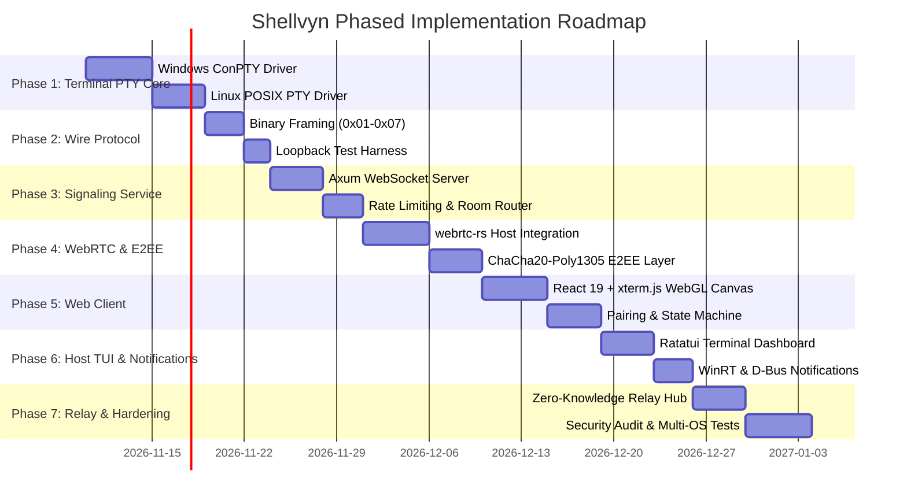

# Implementation Roadmap & Verification Plan

## 1. Overview & Execution Strategy

This implementation roadmap outlines the engineering phases to build **Shellvyn** based on the architectural findings and technical specifications developed in this study.

Per the primary project directive:
> **"Do not begin implementation until the investigation and architecture documentation have been completed and reviewed."**

This roadmap provides the structured blueprint ready for implementation once architecture review and sign-off are complete.

---

## 2. Phase-by-Phase Roadmap

---

## 3. Phase Details & Acceptance Criteria

### Phase 1: Cross-Platform Terminal Engine (Rust)
- **Objective**: Build the `TerminalManager` trait and its platform drivers.
- **Tasks**:
  1. Implement `ConPtyManager` for Windows using `windows-sys`:
     - Pipe allocation, `CreatePseudoConsole`, process launch with `PROC_THREAD_ATTRIBUTE_PSEUDOCONSOLE`.
     - Shell resolution: `pwsh.exe` $\to$ `powershell.exe` $\to$ `cmd.exe`.
  2. Implement `PosixPtyManager` for Linux using `nix`:
     - `openpty`, `login_tty`, fork-exec of `$SHELL`, `ioctl(TIOCSWINSZ)`.
  3. Ensure UTF-8 streaming and clean process cleanup on drop.
- **Acceptance Criteria**: Standalone CLI test spawns shell, captures input/output interactively, and resizes accurately without character corruption.

### Phase 2: Binary Framing & Loopback Transport
- **Objective**: Standardize wire protocol and establish local test harness.
- **Tasks**:
  1. Implement binary framing encoder/decoder in Rust:
     - `0x01` DATA, `0x02` RESIZE, `0x03` CLOSE, `0x04` PING, `0x05` PONG, `0x06` PERMISSION.
  2. Build an in-memory loopback transport for unit testing without network dependencies.
- **Acceptance Criteria**: 100% roundtrip test coverage verifying payload integrity and big-endian dimension packing.

### Phase 3: Signaling & Pairing Service
- **Objective**: Stand up the discovery and coordination tier.
- **Tasks**:
  1. Build an `axum` WebSocket service managing pairing codes.
  2. Implement 8-character Crockford Base32 generator with 5-minute TTL.
  3. Implement token-bucket rate limiter (per-IP and per-machine ID).
- **Acceptance Criteria**: Successfully handles 1,000 concurrent client pairings under load tests; rejects brute-force attempts after 3 failures.

### Phase 4: WebRTC DataChannel & E2EE Layer
- **Objective**: Establish secure direct peer-to-peer streaming.
- **Tasks**:
  1. Integrate `webrtc-rs` on the host agent with STUN configuration.
  2. Connect signaling exchange: SDP offer/answer + Trickle ICE candidates.
  3. Implement ChaCha20-Poly1305 AEAD layer using HKDF-derived session keys.
- **Acceptance Criteria**: Browser and Host establish a direct DataChannel connection across different subnets; verifies encrypted packets over Wireshark.

### Phase 5: Shellvyn Web Client
- **Objective**: Deliver a responsive browser interface.
- **Tasks**:
  1. Scaffold React 19 + TypeScript + Vite project.
  2. Implement `@xterm/xterm` with `@xterm/addon-webgl` and `@xterm/addon-fit`.
  3. Implement pairing code UI with auto-focus, paste detection, and error shake animation.
  4. Build `SignalingClient` and `PeerSession` with Web Crypto API E2EE decryption.
- **Acceptance Criteria**: Sub-50ms keystroke-to-screen latency on local networks; flawless rendering of `htop`, `tmux`, and `vim`.

### Phase 6: Host TUI, Tray & System Integrations
- **Objective**: Build user-friendly host management.
- **Tasks**:
  1. Build a `ratatui` terminal interface showing pairing code, active connections, and session duration.
  2. Implement authorization prompt: Interactive vs Read-Only toggle.
  3. Add desktop notifications: Windows WinRT Toast notifications and Linux D-Bus `notify-send`.
  4. Implement sleep prevention: Win32 `SetThreadExecutionState` on Windows; D-Bus ScreenSaver inhibit on Linux.
- **Acceptance Criteria**: Host receives visual desktop alert when viewer requests access; can approve with a single keypress.

### Phase 7: Zero-Knowledge Relay & Verification
- **Objective**: Complete enterprise fallback path.
- **Tasks**:
  1. Implement WebSocket Relay hub in the signaling service.
  2. Connect browser and agent relay fallback when WebRTC ICE fails.
  3. Verify zero-knowledge guarantee: Relay server logs show only opaque ciphertext.
- **Acceptance Criteria**: Session seamlessly falls back to Relay when UDP/STUN is blocked; latency remains under 100ms.

---

## 4. Risk Analysis & Mitigation Matrix

| Identified Risk | Severity | Mitigation Strategy |
| :--- | :---: | :--- |
| **ConPTY Legacy Windows Glitches** | Medium | Check Windows build number at startup; require Windows 10 Build 1809+; fallback to basic pipe wrapper on legacy servers. |
| **Symmetric NAT Traversal Failure** | High | Provide Zero-Knowledge E2EE Relay fallback with ChaCha20-Poly1305 encryption. |
| **High Output Flood (Buffer Overflow)** | Medium | Implement explicit WebRTC backpressure: pause PTY read loop when `bufferedAmount > 1MB` until low threshold triggers. |
| **Viewer Command Injection / Malicious Input** | Critical | Default to Host Authorization prompt; provide dedicated "Read-Only" mode; sanitize child process environment. |
