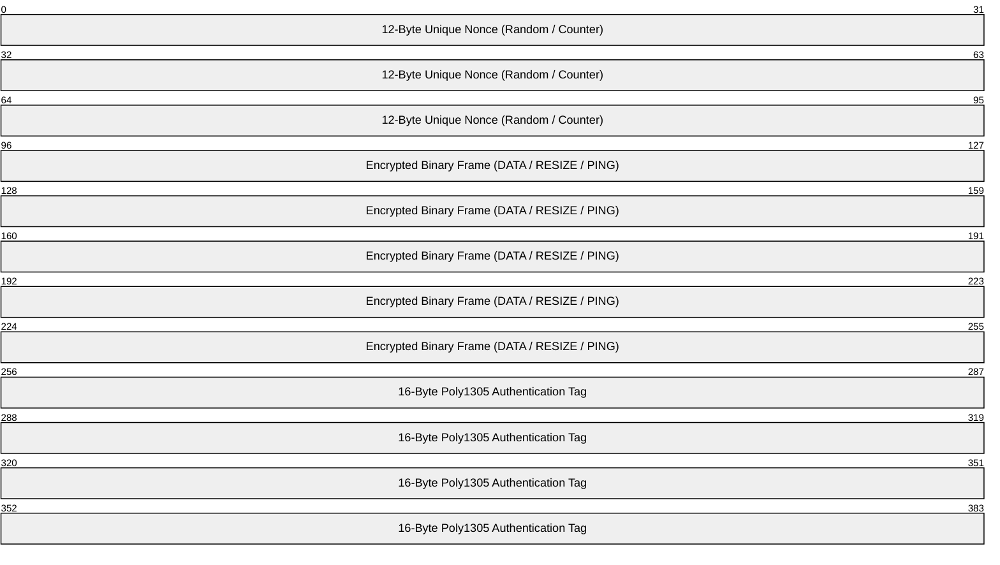

# Shellvyn Protocol Specification (v2)

## 1. Overview & Protocol Architecture

Shellvyn uses a two-layer protocol design:
1. **Signaling Layer** (JSON over WebSocket): Used for peer discovery, pairing handshake, authorization negotiation, and WebRTC SDP/ICE exchange.
2. **Binary Wire Layer** (Binary Framed Packets over WebRTC DataChannel or Encrypted Relay): Streams raw keystrokes, terminal ANSI output, window resize events, and keep-alive signals.

---

## 2. Pairing Code Format & Entropy Specification

### 2.1 Code Syntax
Unlike Skyping's 6-digit decimal code ($10^6$ combinations), Shellvyn adopts an **8-character Crockford Base32** alphanumeric format:
- **Alphabet**: `0123456789ABCDEFGHJKMNPQRSTVWXYZ` (excludes confusing characters `I`, `L`, `O`, and `U`).
- **Display Format**: `XXXX-XXXX` (e.g. `KV7M-9X2P`).
- **Case Insensitivity**: Auto-uppercased by the web client.

### 2.2 Entropy Comparison

$$\text{Skyping (6 Decimal Digits)}: 10^6 = 1,000,000 \text{ combinations} \approx 19.93 \text{ bits}$$
$$\text{Shellvyn (8 Base32 Chars)}: 32^8 = 1,099,511,627,776 \text{ combinations} \approx 40.00 \text{ bits}$$

**Result**: Shellvyn offers more than **$1,000,000\times$ higher entropy**, making online brute-force attacks mathematically infeasible under our rate limiting.

---

## 3. Signaling Protocol Specification (JSON / WebSocket)

### 3.1 Host Registration Handshake

#### Host $\to$ Server: `register`
Sent by the host agent upon establishing the signaling WebSocket connection.
```json
{
  "type": "register",
  "version": "2.0.0",
  "code": "KV7M-9X2P",
  "hostname": "Aashish-Desktop",
  "os": "windows" // "windows" | "linux" | "macos"
}
```

#### Server $\to$ Host: `registered`
```json
{
  "type": "registered",
  "status": "ok",
  "expires_in": 300 // Code valid for 300 seconds (5 minutes)
}
```

---

### 3.2 Viewer Pairing Handshake

#### Viewer $\to$ Server: `join`
Sent by the web client when the user enters the pairing code.
```json
{
  "type": "join",
  "code": "KV7M-9X2P"
}
```

#### Server $\to$ Host: `pair_request`
The signaling server looks up the host registered with `KV7M-9X2P` and forwards the request along with viewer network metadata.
```json
{
  "type": "pair_request",
  "client_id": "c7a8b9e1-3f2d-4b8a-9e12-8f9d0c1b2a3c",
  "remote_ip": "198.51.100.24",
  "user_agent": "Mozilla/5.0 (Windows NT 10.0; Win64; x64) Chrome/131.0"
}
```

#### Host $\to$ Server: `pair_accept` / `pair_reject`
The host user approves or rejects the request via the TUI or system notification.
```json
// Approved
{
  "type": "pair_accept",
  "client_id": "c7a8b9e1-3f2d-4b8a-9e12-8f9d0c1b2a3c",
  "permission": "interactive" // "interactive" | "read_only"
}

// Rejected
{
  "type": "pair_reject",
  "client_id": "c7a8b9e1-3f2d-4b8a-9e12-8f9d0c1b2a3c",
  "reason": "user_declined"
}
```

#### Server $\to$ Viewer: `join_result`
```json
{
  "type": "join_result",
  "status": "connected", // "connected" | "rejected" | "invalid_code" | "expired"
  "host_id": "h3f2a1b0-9c8d-4e7f-a1b2-c3d4e5f6a7b8",
  "hostname": "Aashish-Desktop",
  "permission": "interactive",
  "mode": "webrtc" // "webrtc" | "relay"
}
```

---

### 3.3 WebRTC Negotiation

#### Viewer $\to$ Host: `sdp_offer`
```json
{
  "type": "sdp_offer",
  "host_id": "h3f2a1b0-9c8d-4e7f-a1b2-c3d4e5f6a7b8",
  "sdp": {
    "type": "offer",
    "sdp": "v=0\r\no=- 4829103912 ...\r\n..."
  }
}
```

#### Host $\to$ Viewer: `sdp_answer`
```json
{
  "type": "sdp_answer",
  "client_id": "c7a8b9e1-3f2d-4b8a-9e12-8f9d0c1b2a3c",
  "sdp": {
    "type": "answer",
    "sdp": "v=0\r\no=- 8392183912 ...\r\n..."
  }
}
```

#### Bi-directional: `ice_candidate`
```json
{
  "type": "ice_candidate",
  "target_id": "...",
  "candidate": {
    "candidate": "candidate:1 1 UDP 2122260223 192.168.1.50 58214 typ host ...",
    "sdpMid": "0",
    "sdpMLineIndex": 0
  }
}
```

---

## 4. Binary Framing Wire Protocol (v2)

All terminal data streamed over WebRTC DataChannel or Relay uses a 1-byte opcode header:

| Opcode | Name | Binary Layout | Description |
| :---: | :--- | :--- | :--- |
| `0x01` | **DATA** | `[0x01, ...utf8_bytes]` | Keystroke input (viewer $\to$ host) or terminal output (host $\to$ viewer). |
| `0x02` | **RESIZE** | `[0x02, cols: u16 BE, rows: u16 BE]` | 5-byte packet specifying new terminal dimensions. |
| `0x03` | **CLOSE** | `[0x03, ...reason_utf8]` | Clean disconnect signal with diagnostic text. |
| `0x04` | **PING** | `[0x04]` | Heartbeat ping probe. |
| `0x05` | **PONG** | `[0x05]` | Heartbeat pong reply. |
| `0x06` | **PERMISSION** | `[0x06, 0x00]` or `[0x06, 0x01]` | Host dynamically changes permission: `0x00` = Read-Only, `0x01` = Interactive. |
| `0x07` | **AUTH_CHALLENGE** | `[0x07, 32-byte Random Nonce]` | Mutual verification handshake on connection startup. |

---

## 5. End-to-End Encryption (E2EE) Specification

In Relay Mode (or optional strict P2P mode), packets are protected by **ChaCha20-Poly1305 Authenticated Encryption with Associated Data (AEAD)**:



1. **Key Derivation**:
   Both peers derive a 256-bit symmetric key $K_{E2EE}$ from the pairing code and a shared session salt exchanged during signaling:
   $$K_{E2EE} = \text{HKDF-Extract-and-Expand}(\text{Secret} = \text{PairingCode}, \text{Salt} = \text{SessionSalt}, \text{Info} = \text{"Shellvyn-E2EE-v2"})$$
2. **Encryption**:
   $$\text{Ciphertext}, \text{Tag} = \text{ChaCha20-Poly1305}(K_{E2EE}, \text{Nonce}, \text{FrameData})$$
3. **Zero-Knowledge Guarantee**:
   The signaling server only sees opaque encrypted blobs. Keystrokes, passwords, command lines, and outputs remain strictly confidential between browser and host.
