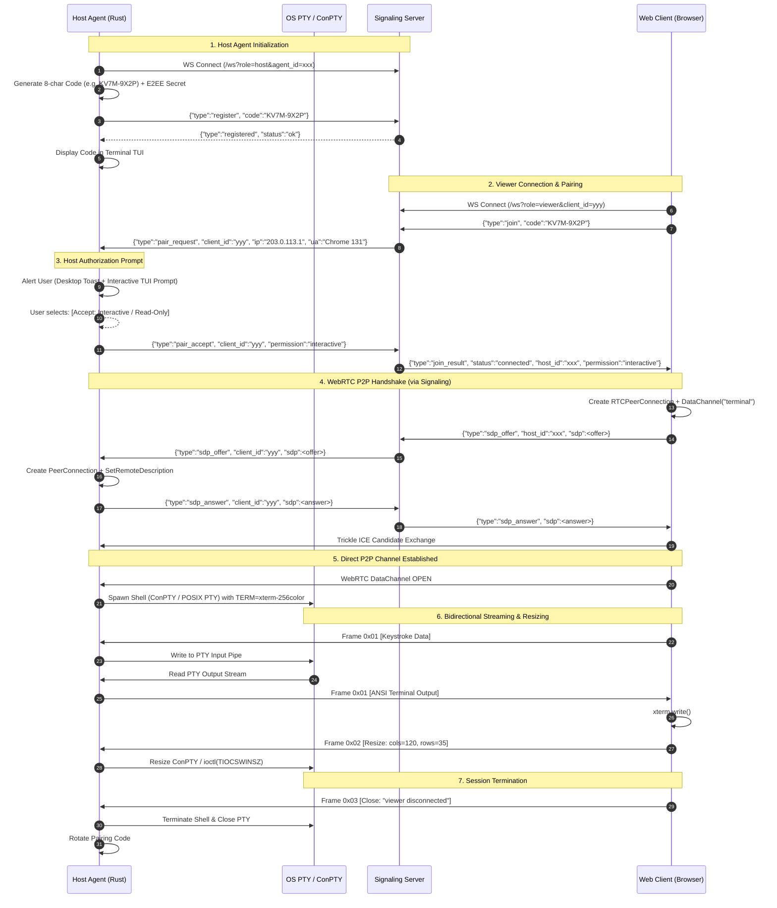

# Shellvyn System Architecture

## 1. System Overview

**Shellvyn** is an independent, secure, cross-platform terminal-sharing product engineered for **Windows 10/11 / Windows Server** and **Linux (Ubuntu, Debian, Fedora, Arch)**, with future support for macOS.

It allows developers, system administrators, and educators to share live, interactive terminal sessions instantly through any modern web browser without opening firewall ports, setting up VPNs, or exposing unauthenticated network daemons.

```mermaid
graph TB
    subgraph Browser_Client [Shellvyn Web Client (React + TypeScript + xterm.js)]
        UI[Pairing & Terminal UI]
        XTERM[xterm.js Terminal Canvas]
        WTC[WebRTC PeerSession]
        RLC[E2EE RelaySession]
        CRYPTO_W[E2EE Crypto Engine]
        UI --> XTERM
        XTERM --> WTC
        XTERM --> RLC
        WTC <--> CRYPTO_W
        RLC <--> CRYPTO_W
    end

    subgraph Signaling_Tier [Signaling & Relay Service (Rust / Axum)]
        WS_GATEWAY[WebSocket Gateway]
        SESSION_MGR[Pairing & Session Router]
        RATE_LIMITER[Token Bucket Rate Limiter]
        RELAY_HUB[Encrypted Zero-Knowledge Relay Hub]
        WS_GATEWAY --> RATE_LIMITER
        RATE_LIMITER --> SESSION_MGR
        SESSION_MGR --> RELAY_HUB
    end

    subgraph Host_Agent [Shellvyn Host Agent (Rust / Tokio)]
        AGENT_CORE[Host Session Coordinator]
        SIG_CLIENT[Signaling Client]
        RTC_ENGINE[WebRTC Engine (webrtc-rs)]
        RL_ENGINE[Relay Engine]
        CRYPTO_H[E2EE Crypto Engine]
        TERM_MGR[Terminal Process Manager]
        
        AGENT_CORE --> SIG_CLIENT
        AGENT_CORE --> RTC_ENGINE
        AGENT_CORE --> RL_ENGINE
        RTC_ENGINE <--> CRYPTO_H
        RL_ENGINE <--> CRYPTO_H
        AGENT_CORE --> TERM_MGR
    end

    subgraph OS_Subsystems [Operating System Execution]
        subgraph Windows_Platform [Windows Subsystem]
            CONPTY[ConPTY PseudoConsole]
            WIN_SHELL[PowerShell / CMD]
            CONPTY --> WIN_SHELL
        end
        subgraph Linux_Platform [Linux Subsystem]
            POSIX_PTY[POSIX /dev/ptmx]
            LIN_SHELL[Bash / Zsh / Fish]
            POSIX_PTY --> LIN_SHELL
        end
    end

    TERM_MGR -. Windows .-> CONPTY
    TERM_MGR -. Linux .-> POSIX_PTY

    %% Network Connections
    Browser_Client <-- WebSocket (Signaling / Discovery) --> WS_GATEWAY
    Host_Agent <-- WebSocket (Signaling / Registration) --> WS_GATEWAY
    Browser_Client <== Direct P2P WebRTC DataChannel (DTLS-SRTP) ==> Host_Agent
    Browser_Client <-. E2EE Fallback Relay Stream (ChaCha20-Poly1305) .-> RELAY_HUB
    RELAY_HUB <-. E2EE Fallback Relay Stream (ChaCha20-Poly1305) .-> Host_Agent
```

---

## 2. Core Components

### 2.1 Shellvyn Web Client
- **Tech Stack**: React 19, TypeScript, Vite, Tailwind CSS v4.
- **Terminal Rendering**: `@xterm/xterm` (v5+) with WebGL renderer addon (`@xterm/addon-webgl`) and fit addon (`@xterm/addon-fit`).
- **Transport Abstraction**: A unified `ITransportSession` interface that abstracts both WebRTC DataChannel and Encrypted WebSocket Relay.
- **Crypto Subsystem**: Web Crypto API (`crypto.subtle`) executing ChaCha20-Poly1305 / AES-256-GCM for Zero-Knowledge Relay encryption.

### 2.2 Shellvyn Host Agent
- **Tech Stack**: Rust (edition 2021) compiled to static native binaries (`shellvyn.exe` for Windows, `shellvyn` for Linux).
- **Async Runtime**: `tokio` (multi-threaded work-stealing reactor).
- **Terminal Management**: Platform-specific implementations of the `TerminalManager` trait:
  - Windows: `ConPtyManager` using Win32 `CreatePseudoConsole`.
  - Linux: `PosixPtyManager` using `nix::pty::openpty`.
- **P2P Engine**: `webrtc-rs` (native Rust async WebRTC stack, no C++ WebRTC dependencies).
- **TUI & Notifications**: Native terminal UI (`ratatui`) with desktop notifications (Windows WinRT Toasts / Linux D-Bus notifications).

### 2.3 Terminal Process Manager
Responsible for the full lifecycle of spawned shells:
1. Spawns child shells (`powershell.exe`, `cmd.exe`, `/bin/bash`, `/bin/zsh`).
2. Redirects standard I/O pipes into the pseudo-terminal master.
3. Propagates resize events (`cols`, `rows`) seamlessly to the running shell without breaking full-screen CLI apps (`vim`, `htop`, `fzf`).
4. Performs process tree cleanup upon session disconnect to prevent orphan processes.

### 2.4 Signaling & Relay Service
- **Tech Stack**: Rust with `axum` and `tokio-tungstenite`.
- **Stateless Router**: Maintains in-memory session pairings between host agents and joining browsers.
- **Zero-Knowledge Design**: In relay mode, acts strictly as a pipe for pre-encrypted binary frames. Does not hold session decryption keys.
- **Rate Limiting**: IP-based and machine-based token bucket to prevent pairing code brute-forcing.

---

## 3. End-to-End Session Lifecycle



---

## 4. Platform Architectural Specifications

### 4.1 Windows Implementation Details
- **PTY Subsystem**: Microsoft Windows Pseudo Console (`ConPTY`), supported on Windows 10 (build 1809+) and Windows 11.
- **Process Spawning**: Uses Win32 `CreateProcessW` with `STARTUPINFOEXW` and `PROC_THREAD_ATTRIBUTE_PSEUDOCONSOLE`.
- **Shell Discovery**:
  1. Checks for PowerShell 7+ (`pwsh.exe`).
  2. Falls back to Windows PowerShell 5.1 (`powershell.exe`).
  3. Falls back to Command Prompt (`cmd.exe`).
- **Sleep Prevention**: Calls Win32 `SetThreadExecutionState(ES_CONTINUOUS | ES_SYSTEM_REQUIRED | ES_AWAYMODE_REQUIRED)`.

### 4.2 Linux Implementation Details
- **PTY Subsystem**: POSIX pseudo-terminals (`/dev/ptmx`, `openpty`).
- **Process Spawning**: Fork-exec using `nix::unistd::fork` and `nix::pty::login_tty`.
- **Shell Discovery**: Reads user `$SHELL`, falling back to `/bin/bash` or `/bin/sh`.
- **Signal & Window Management**:
  - Sets terminal attributes: raw mode with `termios`.
  - Sends `SIGWINCH` to foreground process group upon resize.
  - Intercepts `SIGCHLD` via `tokio::signal::unix::signal` to clean up child processes.
- **Sleep Prevention**: Requests a D-Bus sleep inhibit lock from `org.freedesktop.ScreenSaver` or `systemd-inhibit`.
