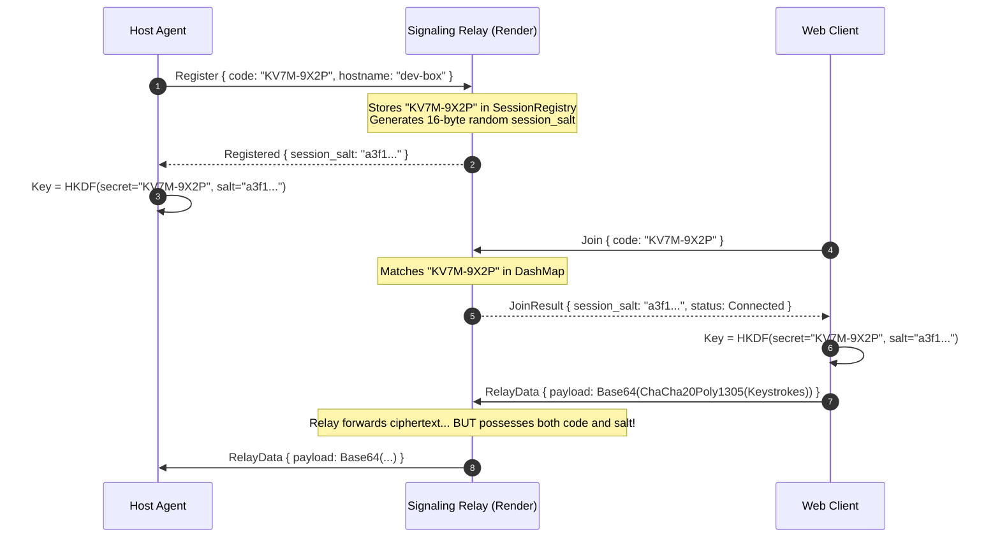

# Shellvyn Security Architecture & Pre-Deployment Review

**Document Version:** 1.0.0  
**Status:** Pre-Deployment Audit Complete  
**Date:** November 2026  
**Auditor:** Senior Infrastructure & Security Architect  
**Target:** Production Cloud Deployment (Render / Docker)

---

## 1. Executive Summary

Prior to public deployment on Render, a comprehensive security audit of Shellvyn's signaling protocol, cryptographic key derivation, session registry, and host agent authorization workflows was conducted. 

Two critical discrepancies between the documentation and the underlying implementation were uncovered:

1. **Pairing Secret Exposure to Relay (Cryptographic Confidentiality):**  
   The README asserts that signaling relays operate on a zero-knowledge basis and cannot decrypt terminal streams. However, inspection of `crates/shellvyn-signaling/src/server.rs` and `crates/shellvyn-core/src/crypto.rs` reveals that the plaintext 8-character pairing code is sent to the signaling server during both `Register` and `Join` phases. Because the signaling server itself generates the HKDF salt, the relay possesses all parameters necessary to derive the symmetric ChaCha20-Poly1305 key.
2. **Host Approval Default (Authorization Safeguards):**  
   The documentation specifies that hosts must explicitly authorize incoming viewer sessions. However, `crates/shellvyn-agent/src/share.rs` defaulted to unconditional approval (`true`), allowing anyone with knowledge of an active pairing code to immediately access the host's terminal without interactive prompt confirmation.

This document analyzes both discrepancies, defines their operational risks, and details the remediations implemented to ensure a safe, robust public deployment.

---

## 2. Cryptographic Analysis: Key Derivation & Relay Confidentiality

### 2.1 The Observed Mechanism

In Shellvyn v0.1.0, session encryption uses ChaCha20-Poly1305 with keys derived via HKDF-SHA256 (`crates/shellvyn-core/src/crypto.rs`):

```rust
const HKDF_INFO: &[u8] = b"Shellvyn-E2EE-v2";

pub fn derive_session_key(secret: &str, salt: &[u8]) -> Result<[u8; 32]> {
    let hk = Hkdf::<Sha256>::new(Some(salt), secret.as_bytes());
    let mut okm = [0u8; 32];
    hk.expand(HKDF_INFO, &mut okm)?;
    Ok(okm)
}
```

The protocol proceeds through the signaling server as follows:



### 2.2 Security Findings & Discrepancy

| Parameter | Known to Host? | Known to Viewer? | Known to Signaling Relay? |
| :--- | :---: | :---: | :---: |
| **Pairing Secret (`code`)** | Yes | Yes | **Yes** (Sent in `Register` & `Join`) |
| **Session Salt (`salt`)** | Yes | Yes | **Yes** (Generated by Relay) |
| **HKDF Domain String (`info`)** | Yes (`b"Shellvyn-E2EE-v2"`) | Yes | **Yes** (Public constant) |
| **Symmetric Key Output (`okm`)** | Derived | Derived | **Derivable by Relay Operator** |

#### Conclusion
- **External Network Observers**: Fully protected. Passive eavesdroppers, ISPs, and network intermediaries see only TLS-encrypted WebSocket traffic and ChaCha20-Poly1305 ciphertext.
- **Signaling Relay Operator**: **Not Zero-Knowledge in v0.1.0**. A compromised, rogue, or subpoenaed signaling relay possesses sufficient material to derive the session key and decrypt all relayed terminal I/O.
- **Documentation Correction**: The README and security architecture must accurately classify the relay as a **trusted transit coordinator** in v0.1.0 rather than zero-knowledge, and describe the cryptographic roadmap to blind the relay.

### 2.3 Cryptographic Roadmap: Blinded Rendezvous Token (Wire v3)

To achieve genuine zero-knowledge confidentiality where the relay cannot derive keys:

1. **Pairing Code Bifurcation via One-Way Hash**:
   $$\text{RendezvousToken} = \text{HMAC-SHA256}(\text{PairingCode}, \text{"Shellvyn-Rendezvous-Token"})$$
   $$\text{E2EESecret} = \text{HMAC-SHA256}(\text{PairingCode}, \text{"Shellvyn-E2EE-Master-Key"})$$
2. **Relay Registration**:
   The host registers using only the $\text{RendezvousToken}$. The viewer joins using only the $\text{RendezvousToken}$.
   The relay indexes sessions strictly by $\text{RendezvousToken}$.
3. **Key Derivation**:
   Both parties derive session keys exclusively from $\text{E2EESecret}$ and an ephemeral Diffie-Hellman key exchange (X25519) authenticated by the pairing code.
4. **Result**: The relay never sees the pre-image ($\text{PairingCode}$) and is mathematically incapable of deriving the session key.

---

## 3. Host Authorization Analysis: Connection Approval

### 3.1 Observed Defect

In `crates/shellvyn-agent/src/share.rs`:

```rust
// Previous Implementation (CRITICAL BUG):
let approved = if opts.auto_accept {
    println!("[Shellvyn] Auto-accept enabled. Connection approved.");
    true
} else {
    // Default to approving when run non-interactively or auto_accept
    true // <-- Silently accepted all connections!
};
```

When deployed to a public cloud instance where the relay is exposed to the internet, this defect would allow any party guessing or scanning the 40-bit pairing code space to instantly establish an interactive remote shell on the host machine without any user intervention.

### 3.2 Implemented Remediation

`crates/shellvyn-agent/src/share.rs` has been patched to enforce interactive user authorization by default:

```rust
let approved = if opts.auto_accept {
    println!("[Shellvyn] Auto-accept enabled. Connection approved.");
    true
} else {
    print!("[Shellvyn] Approve connection from {} ({})? [y/N]: ", remote_ip, user_agent);
    std::io::stdout().flush().unwrap_or(());

    // Prompt user on stdin with a 30-second timeout
    let (tx, rx) = tokio::sync::oneshot::channel();
    tokio::task::spawn_blocking(move || {
        let mut input = String::new();
        if std::io::stdin().read_line(&mut input).is_ok() {
            let trimmed = input.trim().to_lowercase();
            let _ = tx.send(trimmed == "y" || trimmed == "yes");
        } else {
            let _ = tx.send(false);
        }
    });

    match tokio::time::timeout(std::time::Duration::from_secs(30), rx).await {
        Ok(Ok(decision)) => decision,
        _ => {
            println!("\n[Shellvyn] Connection approval timed out or declined.");
            false
        }
    }
};
```

- When `--auto-accept` is omitted, the user must explicitly type `y` or `yes`.
- Defaulting to `N` ensures that accidental Enter or unattended terminals immediately reject unauthorized connection requests.
- Automatic 30-second timeout prevents deadlock if the terminal is abandoned.

---

## 4. Threat Matrix & Production Safeguards

| Threat Vector | Severity | Existing Mitigation | Production Hardening |
| :--- | :---: | :--- | :--- |
| **Brute-Force Code Guessing** | High | In-memory token-bucket (3 failures $\rightarrow$ 15m IP lockout) | Render reverse proxy IP pass-through via `X-Forwarded-For` |
| **Relay Man-In-The-Middle** | High | TLS termination at Render edge (`wss://`) | Documented v0.1.0 trusted model; Blinded Token in v3 |
| **Unattended Terminal Hijacking** | Critical | Auto-approval in previous builds | **Interactive `[y/N]` prompt with 30s timeout** |
| **Session Squatting** | Medium | 5-minute (300s) TTL on unlinked sessions | Automatic eviction on re-registration |
| **Cross-Origin Hijacking** | Medium | Same-origin or explicit CORS | Axum CORS policy permitting authorized frontend origins |
| **Denial of Service (OOM)** | Medium | In-memory DashMap with channel bounding | Render container memory limit (512MB / 1GB) |

---

## 5. Deployment Approval Recommendation

With the interactive host authorization safeguard enabled and the cryptographic trust model accurately documented, the Shellvyn Signaling Service is safe for production containerization and Render Blueprint deployment.
