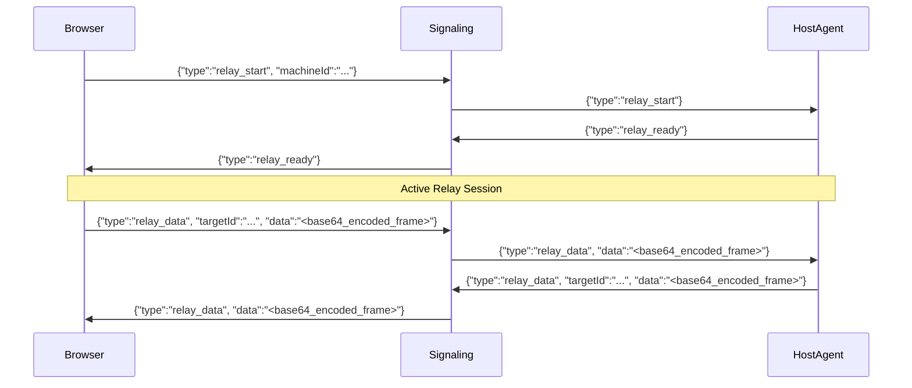

# Networking Analysis: Signaling, WebRTC, and Relay Topology

## 1. Network Topology Architecture

Skyping implements a **hybrid peer-to-peer / relay architecture**:

```mermaid
flowchart TD
    subgraph Signaling_Tier [Cloudflare Edge]
        SIG[WebSocket Signaling Service<br/>wss://signalling-s1.skyping.app/ws]
    end

    subgraph Host_Agent [Host Machine: Private LAN]
        HA[Skyping Host Agent]
        PTY[Shell / ConPTY / PTY]
        HA <--> PTY
    end

    subgraph Browser_Peer [Remote Viewer]
        BC[Web Browser Client]
        XT[xterm.js Canvas]
        BC <--> XT
    end

    subgraph STUN_Infrastructure [Google STUN]
        STUN[stun:stun.l.google.com:19302]
    end

    %% Signaling phase
    HA -- 1. WS Connect (?role=agent) --> SIG
    BC -- 2. WS Connect (?role=browser) --> SIG
    BC -- 3. Join with Code --> SIG
    SIG -- 4. Pair Request --> HA
    HA -- 5. Pair Accept --> SIG
    SIG -- 6. Join Result (OK) --> BC

    %% ICE / STUN phase
    BC -- Discover Public Reflexive Candidates --> STUN
    HA -- Discover Public Reflexive Candidates --> STUN
    BC -- 7. SDP Offer + ICE --> SIG
    SIG -- Route Offer --> HA
    HA -- 8. SDP Answer + ICE --> SIG
    SIG -- Route Answer --> BC

    %% Direct P2P DataChannel
    HA <== 9. Direct P2P WebRTC DataChannel (DTLS / SCTP) ==> BC

    %% Fallback Relay
    HA -. 10. Fallback: Base64 Relay Data .- SIG
    SIG -. Fallback: Base64 Relay Data .- BC
```

---

## 2. Signaling Protocol Specification

The signaling server coordinates discovery, pairing validation, and WebRTC SDP/ICE negotiation over a persistent WebSocket connection.

### 2.1 Connection Handshake
- **Host Agent**: `wss://signalling-s1.skyping.app/ws?role=agent&id=<machineId>`
- **Browser Client**: `wss://signalling-s1.skyping.app/ws?role=browser&id=<browserId>`
- **Local Dev Endpoint**: `ws://localhost:8787/ws` (Derived from Cloudflare Wrangler dev server default).

### 2.2 Signaling Message Schemas (JSON)

#### 1. Code Association & Join
```json
// Browser -> Signaling: Request to pair using 6-digit code
{
  "type": "join",
  "code": "483-291"
}

// Signaling -> Host Agent: Notify that a browser wants to pair
{
  "type": "pair_request",
  "browserId": "550e8400-e29b-41d4-a716-446655440000"
}

// Host Agent -> Signaling: Host approves connection
{
  "type": "pair_accept",
  "browserId": "550e8400-e29b-41d4-a716-446655440000"
}

// Signaling -> Browser: Join confirmed
{
  "type": "join_result",
  "status": "connected",
  "machineId": "macbook-pro-8319",
  "hostname": "Aashish-MacBook.local",
  "mode": "webrtc" // or "relay"
}
```

#### 2. WebRTC Session Negotiation
```json
// Browser -> Signaling -> Host Agent: SDP Offer
{
  "type": "sdp_offer",
  "machineId": "macbook-pro-8319",
  "sdp": {
    "type": "offer",
    "sdp": "v=0\r\no=- 4239847293 ...\r\n..."
  }
}

// Host Agent -> Signaling -> Browser: SDP Answer
{
  "type": "sdp_answer",
  "sdp": {
    "type": "answer",
    "sdp": "v=0\r\no=- 8392183912 ...\r\n..."
  }
}

// Bi-directional Trickle ICE Candidate Exchange
{
  "type": "ice_candidate",
  "targetId": "macbook-pro-8319", // or browserId
  "candidate": {
    "candidate": "candidate:842163049 1 udp 1677729535 192.168.1.42 54312 typ host ...",
    "sdpMid": "0",
    "sdpMLineIndex": 0
  }
}
```

#### 3. Heartbeat & Liveness
```json
// Every 20 seconds
{
  "type": "heartbeat"
}
```

---

## 3. WebRTC DataChannel (Primary Transport)

### 3.1 Channel Configuration
- **Channel Label**: `"terminal"`
- **Options**: `{ ordered: true }` (ensures sequence integrity of VT100/ANSI escape sequences).
- **Binary Type**: `"arraybuffer"`
- **Security**: Built-in DTLS 1.2 / 1.3 handshake negotiation producing AES-128-GCM or AES-256-GCM transport encryption.
- **SCTP Transport**: Streams arbitrary binary frames without TCP head-of-line blocking across independent streams.

### 3.2 Flow Control & Buffer Management
To prevent flooding the WebRTC buffer during bulk terminal dumps (e.g. `cat 50MB.log`), the client implements explicit backpressure:
- High Watermark: `dc.bufferedAmount > 1,048,576` bytes (1 MiB).
- Low Watermark Threshold: `dc.bufferedAmountLowThreshold = 524,288` bytes (512 KiB).
- Pause / Resume: Once high watermark is exceeded, writes are suspended until `dc.onbufferedamountlow` fires.

---

## 4. Relay Fallback Mechanism (Secondary Transport)

### 4.1 When Relay is Engaged
1. **Symmetric NATs**: Both peers are behind restrictive enterprise symmetric NATs where STUN candidate binding fails and hole punching is impossible.
2. **UDP Blocking**: Corporate or university firewalls blocking outbound UDP traffic (STUN/WebRTC operates over UDP).
3. **Explicit Override**: Environment variable `SKYPING_RELAY=true` or query parameter `?mode=relay`.

### 4.2 Relay Wire Protocol
Instead of spinning up expensive TURN media servers, Skyping routes relay traffic through the existing Cloudflare WebSocket signaling server:



### 4.3 Relay Security Vulnerability Identified
> [!WARNING]
> In Skyping's relay implementation, the binary frames are converted to Base64 and sent directly through the Cloudflare WebSocket server without application-layer encryption. Any operator or proxy with access to the signaling server can inspect plaintext shell commands, passwords, and file contents!

---

## 5. Architectural Blueprint for Shellvyn's Networking Tier

| Network Requirement | Skyping Implementation | Shellvyn Enhanced Design |
| :--- | :--- | :--- |
| **STUN / TURN** | Only Google public STUN; 0 TURN servers. | Dual STUN + coturn TURN support for high enterprise success rates. |
| **Relay Architecture** | WebSocket server relays Base64 frames in plaintext. | **End-to-End Encryption (E2EE)**: Relay frames are encrypted with ChaCha20-Poly1305 using a key derived from a pairing secret via HKDF. |
| **Signaling Engine** | Cloudflare Workers WebSocket. | High-performance Rust Axum WebSocket signaling server (or Go). Easily self-hostable with Docker. |
| **P2P Implementation** | Go `pion/webrtc`. | Rust `webrtc-rs` (native async Tokio integration). |
| **Zero-Config LAN** | Manual pairing code entry only. | Optional mDNS / Bonjour local LAN discovery for one-click pairing. |
