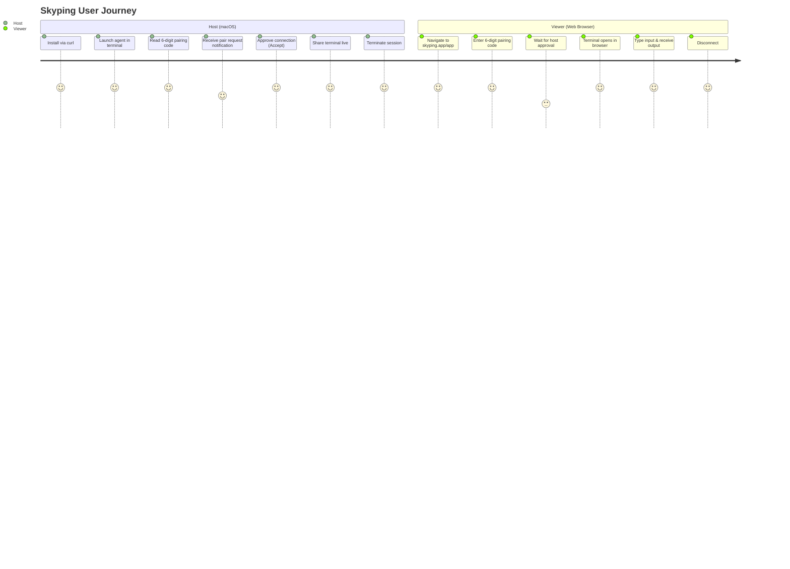

# Product Analysis: Skyping vs. Shellvyn

## 1. Executive Summary

This document presents a comprehensive product analysis of **Skyping** (`https://skyping.app/`), a peer-to-peer terminal-sharing utility created by Piyush Garg, and establishes the product foundation for **Shellvyn**, an independent cross-platform terminal-sharing product for Windows and Linux.

The analysis is based on directly observed behavior, recovered client-side and binary artifacts, and technical evaluations obtained through the REA investigation environment.

---

## 2. Product Overview: Skyping

### 2.1 Value Proposition
Skyping promises instant, peer-to-peer terminal sharing without requiring port forwarding, VPN configuration, account registration, or SSH key management. A host runs a local CLI agent that prints a short 6-digit code. A remote participant enters the code on `https://skyping.app/app` and connects directly to the host's terminal in their web browser.

### 2.2 Target Audience & Use Cases
- **Remote Pair Programming**: Sharing a development environment or debugging a compiler/runtime error with a colleague.
- **Developer Education & Mentorship**: Teaching terminal skills, command-line utilities, or cloud infrastructure hands-on.
- **Incident Response & Triage**: Collaborating on a machine inside a private LAN without creating permanent inbound firewall rules.
- **Quick Technical Demos**: Demonstrating a CLI tool or script output to non-technical stakeholders via a web browser.

### 2.3 User Journey Breakdown

1. **Host Setup**:
   - The user executes `curl -fsSL https://skyping.app/install.sh | bash` in macOS Terminal.
   - The script downloads a standalone Mach-O 64-bit executable `skyping` directly into `/usr/local/bin`.
   - The user runs `skyping`.
   - The agent initializes a terminal TUI, connects to a signaling service, allocates a 6-digit code (e.g. `483-291`), and displays it in the TUI and the macOS menu bar.
2. **Viewer Connection**:
   - The remote user navigates to `https://skyping.app/app`.
   - A minimalist pairing interface accepts 6 digits with auto-focus and auto-hyphenation.
   - The web app sends a join request to the signaling server.
3. **Host Authorization**:
   - The host agent receives a pairing request, triggers a desktop notification via `terminal-notifier`, and shows an interactive prompt in the CLI TUI.
   - The host user must explicitly approve the connection.
4. **Session Establishment**:
   - Upon approval, the signaling server coordinates an SDP offer/answer exchange.
   - A WebRTC DataChannel is created directly between the browser and the host agent.
   - If direct P2P fails (e.g. symmetric NAT), the session transparently falls back to a WebSocket relay.
5. **Interactive Terminal**:
   - The viewer interacts with the remote shell inside an xterm.js canvas in the browser. Input and terminal output stream bidirectionally.

---

## 3. Detailed Feature Comparison

| Feature Dimension | Skyping (Observed Reality) | Shellvyn (Target Product Specification) |
| :--- | :--- | :--- |
| **Supported Host OS** | macOS Only (x86_64 / arm64 Darwin) | **Windows 10/11 & Windows Server (x64/ARM64)** **Linux (x64/ARM64: Ubuntu, Debian, Fedora, Arch)** macOS (Planned Stage 2) |
| **Terminal Subsystem** | POSIX PTY via `creack/pty` (Unix `openpty`/`ioctl`) | **Windows: Windows Pseudo Console (`ConPTY`)** **Linux: POSIX PTY via `nix`/`openpty`** |
| **Default Shells** | macOS `$SHELL` (`/bin/zsh`, `/bin/bash`) | **Windows: PowerShell 7+, Windows PowerShell 5.1, CMD** **Linux: Bash, Zsh, Fish** |
| **Signaling Infrastructure** | Cloudflare Workers WebSocket (`wss://signalling-s1.skyping.app/ws`) | Self-hostable & Managed Rust Signaling Server (Axum / WebSocket) |
| **P2P Data Transport** | WebRTC DataChannel (`github.com/pion/webrtc`) | WebRTC DataChannel (`webrtc-rs` in Rust) |
| **Fallback Relay** | Unencrypted WebSocket relay via signaling server | Encrypted Relay (E2EE ChaCha20-Poly1305 over WebSocket relay) |
| **Access Control** | Binary Host Prompt (Accept/Reject) | **Granular Permissions:** 1. Interactive (Full Shell Access) 2. Read-Only (Observe-only stream) 3. Command Approval Mode |
| **Multi-Viewer Support** | 1:1 single connection per agent | 1:N multi-viewer support (broadcast to multiple teammates) |
| **Security & Privacy** | Plaintext in Relay Mode, No E2EE over relay | **Full End-to-End Encryption (E2EE)** across both P2P and Relay |
| **Session Control** | Host kill switch (`Ctrl+C` or menu exit) | Web client disconnect, Host kill switch, Session Timeout, Inactivity Watchdog |
| **Audit & Recording** | None | Optional Asciinema-compatible session recording (`.cast`) |

---

## 4. Key Architectural Findings & Implications

### Finding 1: Single Platform Lock-in
- **Evidence**: `install.sh` aborts on `[ "$(uname)" != "Darwin" ]`. The compiled binary imports `caffeinate`, `networksetup` (for Wi-Fi SSID discovery), and Darwin-specific syscalls.
- **Confidence Level**: Directly Observed (Binary decompilation & install script inspection).
- **Limitations**: The underlying Go libraries (`pion/webrtc`, `coder/websocket`) are cross-platform, but the terminal PTY and system integrations are hardcoded to macOS.
- **Implications for Shellvyn**: Shellvyn must architect a platform-agnostic `TerminalManager` trait. Windows requires Microsoft's ConPTY API (`CreatePseudoConsole`), while Linux requires POSIX `termios` and `forkpty`.

### Finding 2: Two-Tier Transport Model (WebRTC P2P + WebSocket Relay)
- **Evidence**: Subpackages `internal/agent.NewPeerSession` and `internal/agent.NewRelaySession` exist in the Go binary. Frontend classes `C` (WebRTC) and `k` (Relay) mirror this in `00cwqo-rg0i_3.js`.
- **Confidence Level**: Recovered Implementation Evidence.
- **Limitations**: The relay mode routes raw terminal bytes through the cloud signaling server.
- **Implications for Shellvyn**: Shellvyn must support both P2P and Relay for high connectivity, but **must enforce End-to-End Encryption (E2EE)** so the relay server never inspects terminal bytes.

### Finding 3: Pairing Code Entropy & Lifetime
- **Evidence**: Code is formatted as `XXX-XXX` (6 numeric digits, $10^6$ combinations). Generated by `internal/pairing.NewCodeManager`.
- **Confidence Level**: Directly Observed & Recovered Implementation Evidence.
- **Limitations**: 6 digits is prone to brute force attacks on high-throughput networks without strict IP-based and machine-based rate limiting.
- **Implications for Shellvyn**: Shellvyn will implement:
  1. Time-bounded code expiry (e.g. 5 minutes).
  2. Cryptographic salt in pairing handshake.
  3. Strict signaling rate limiting (max 3 invalid attempts before lockout).
  4. Mandatory host confirmation displaying viewer IP, location, and user-agent.
