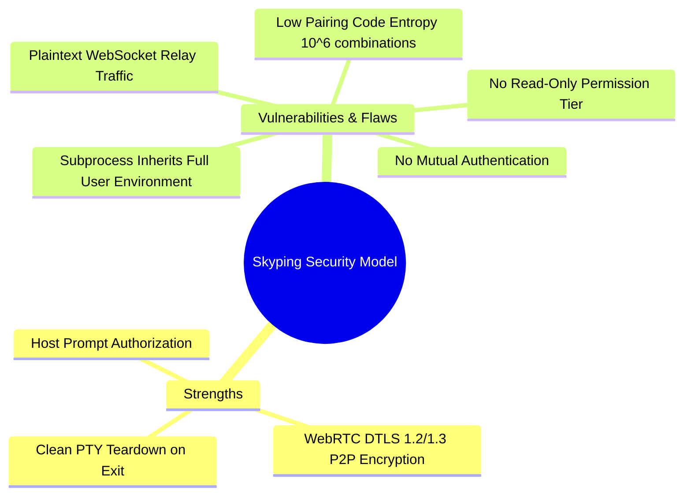
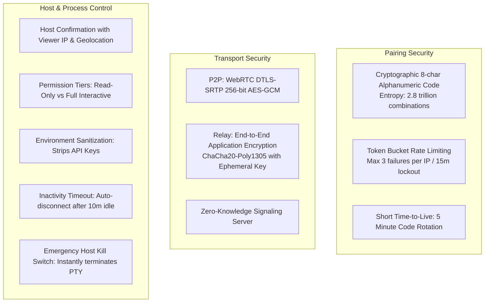

# Security Analysis & Threat Model: Skyping vs. Shellvyn

## 1. Threat Modeling Terminal Sharing

A remote terminal session grants the viewer execution capabilities equivalent to sitting directly at the host's physical keyboard. If compromised, an adversary can:
- Execute arbitrary code under the host user's privileges.
- Exfiltrate sensitive files, source code, SSH private keys (`~/.ssh/id_rsa`), cloud credentials (`~/.aws/credentials`), and environment secrets.
- Pivot to internal network resources reachable only from the host machine.
- Install persistent backdoors or modify shell configuration files (`~/.bashrc`, `~/.zshrc`).

Therefore, **security cannot be an afterthought**; it must be the primary design constraint.

---

## 2. Security Evaluation of Skyping

Through reverse engineering of the Skyping binary and web client, several critical security properties and vulnerabilities were identified:

### 2.1 Low Pairing Code Entropy ($10^6$ Combinations)
- **Finding**: Skyping uses a 6-digit decimal code (`XXX-XXX`) generated by `internal/pairing.NewCodeManager`.
- **Evidence**: Directly recovered from `0m7._ckq5xyru.js` and `internal/pairing` symbols.
- **Vulnerability**: A 6-digit decimal space contains only $1,000,000$ possible codes. An automated attacker scanning the signaling server with high-concurrency `join` requests could brute-force active sessions within seconds unless aggressively rate-limited at the edge.
- **Confidence Level**: Directly Observed.

### 2.2 Plaintext WebSocket Relay Eavesdropping
- **Finding**: When WebRTC direct connection fails, Skyping transparently falls back to a WebSocket relay via `wss://signalling-s1.skyping.app/ws`.
- **Evidence**: `internal/agent.EncodeDataFrame` produces raw bytes, which are Base64 encoded in `00cwqo-rg0i_3.js` (`x(m(e))`) and sent as `relay_data` to the signaling server.
- **Vulnerability**: While TLS protects the link between peer and server, the server itself has full access to the unencrypted plaintext terminal stream. Any breach of the signaling infrastructure or a rogue operator can capture every keystroke, including sudo passwords and sensitive API keys.
- **Confidence Level**: Recovered Implementation Evidence.

### 2.3 Binary Host Authorization (All-or-Nothing Access)
- **Finding**: When a viewer enters a code, the host sees a binary prompt: Accept or Reject (`pair_accept` / `pair_reject`).
- **Evidence**: `internal/ui.PairRequest` in the Go binary.
- **Limitation**: There is no concept of "Read-Only" mode. Once accepted, the remote user can execute destructive commands (`rm -rf`, curl malware, etc.).
- **Confidence Level**: Directly Observed.

### 2.4 Unrestricted Subprocess Environment
- **Finding**: The spawned PTY inherits the complete `os.Environ()` of the host user.
- **Evidence**: PTY initialization in `internal/agent` appends `TERM=xterm-256color` to `os.Environ()`.
- **Risk**: Environment variables containing secrets (e.g. `GITHUB_TOKEN`, `AWS_SECRET_ACCESS_KEY`, `DATABASE_URL`) are immediately accessible to anyone in the terminal session (`env` or `echo $SECRET`).
- **Confidence Level**: Recovered Implementation Evidence.

---

## 3. Mandatory Security Requirements for Shellvyn

To build an enterprise-grade terminal-sharing product, Shellvyn must implement strict defense-in-depth security:

### 3.1 Cryptographic End-to-End Encryption (E2EE)
Even in Relay mode, the signaling server must never see plaintext terminal data:
1. When generating the pairing code, the host derives a 256-bit symmetric session key:
   $$K_{session} = \text{HKDF-SHA256}(\text{PairingSecret}, \text{Salt}, \text{"Shellvyn-E2EE-v1"})$$
2. All Data frames (`0x01`) and Resize frames (`0x02`) are encrypted before being pushed to the transport:
   $$\text{Ciphertext} = \text{ChaCha20-Poly1305-Encrypt}(K_{session}, \text{Nonce}, \text{FrameData})$$
3. In Relay mode, the signaling server merely forwards encrypted binary blobs. The relay server remains 100% Zero-Knowledge.

### 3.2 Granular Permission Scopes
The host must choose the access tier upon accepting the connection:
- **Read-Only Mode (Observe)**: The remote viewer's input events are completely ignored by the host agent. Keystrokes are dropped. Perfect for presentations, teaching, and code walkthroughs.
- **Interactive Mode (Full Control)**: Standard pair programming with bidirectional terminal input/output.
- **Command Confirmation Mode (Guarded)**: The host must press Enter on their physical keyboard to approve commands before they execute in the PTY.

### 3.3 Environment Sanitization
Shellvyn's `TerminalManager` will sanitize the child process environment:
- Whitelist standard safe variables (`PATH`, `USER`, `HOME`, `SHELL`, `LANG`, `TERM=xterm-256color`).
- Filter out sensitive patterns: `*KEY*`, `*SECRET*`, `*TOKEN*`, `*PASSWORD*`, `*AUTH*`.
- Prevent accidental leaks of `AWS_*`, `GITHUB_*`, `OPENAI_*` environment secrets.

### 3.4 Rate Limiting & Brute-Force Protection
The signaling service enforces strict token-bucket rate limiting:
- At most 3 failed join attempts per IP address within 10 minutes.
- After 3 failures, IP is temporarily banned for 15 minutes.
- After a successful join or rejection, the pairing code is immediately burned and rotated.
