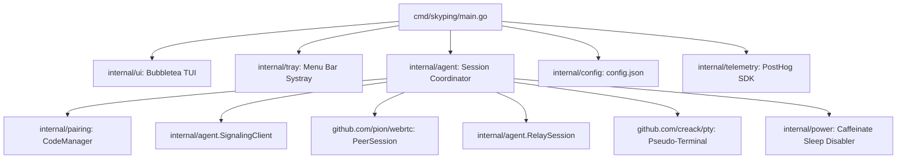
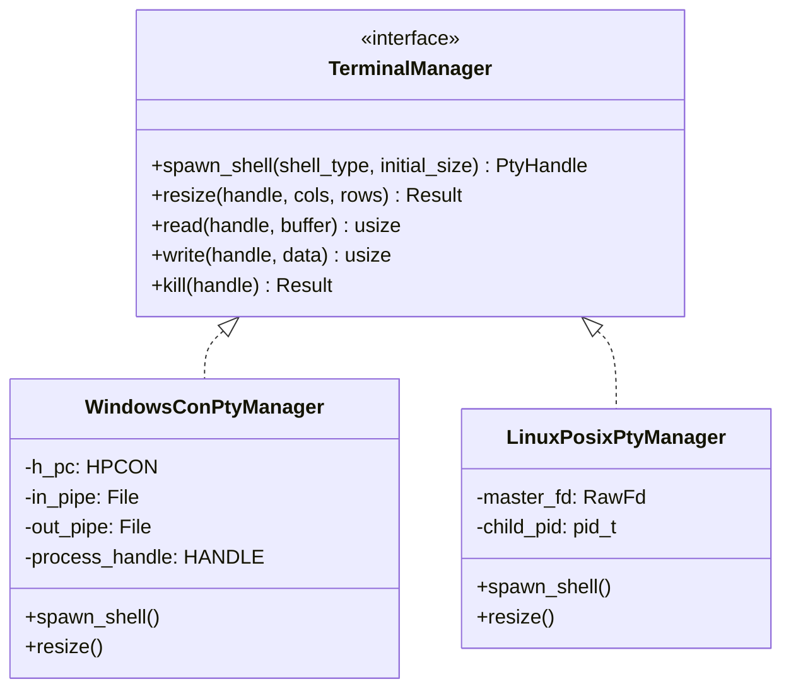

# Terminal Agent Analysis: Skyping Host Agent

## 1. Overview & Binary Profiling

The Skyping host agent executable was downloaded directly from `https://skyping.app/skyping` as referenced in `install.sh`.

### Binary Metadata
- **File Format**: Mach-O 64-bit executable (`MH_MAGIC_64`, `CF FA ED FE`, target: `darwin/arm64` and `darwin/amd64`).
- **Binary Size**: 11,758,562 bytes (~11.7 MiB).
- **Toolchain**: Go 1.22+ runtime, statically compiled with CGO enabled (for macOS Cocoa/CoreFoundation tray hooks).
- **Core Internal Module**: `github.com/skypingapp/cli`.

---

## 2. Package Architecture & Decompiled Symbols

From the symbol tables and string reflection maps recovered via REA, the host agent is structured into clean modular packages:



### 2.1 Package Manifest

| Package Path | Key Types & Functions | Architectural Role |
| :--- | :--- | :--- |
| `cmd/skyping` | `main` | Entrypoint, flag parsing, signal handling (`SIGINT`, `SIGTERM`). |
| `internal/agent` | `New`, `DecodeFrame`, `EncodeDataFrame`, `EncodeCloseFrame`, `EncodePongFrame`, `NewPeerSession`, `NewRelaySession`, `SignalingClient` | Orchestrates network connections, manages I/O streaming, handles protocol frames. |
| `internal/config` | `Load`, `createDefault`, `configPath`, `configDir` | Manages local persistence in `~/Library/Application Support/Skyping/config.json`. |
| `internal/pairing` | `NewCodeManager`, `generate`, `CodeManager` | Generates 6-digit pairing codes (`XXX-XXX`), tracks code rotation and timeouts. |
| `internal/power` | `DisableSleep`, `caffeinate` | Spawns `/usr/bin/caffeinate -d -i -m` to keep macOS awake during active pair sessions. |
| `internal/telemetry` | `Init`, `shouldEnable`, `Client` | PostHog Go client (`us.i.posthog.com`). Configurable via `SKYPING_DO_NOT_TRACK`. |
| `internal/tray` | `Run`, `onReady`, `onExit` | Integrates with macOS menu bar, shows active session count, pairing code, and quit action. |
| `internal/ui` | `ShowStartupAnimation`, `PrintDashboard`, `PairRequest`, `PairAccepted`, `Connected`, `spinnerModel` | Terminal UI built with Charmbracelet `bubbletea` and `lipgloss`. Displays Wi-Fi network name (`networksetup`). |

---

## 3. Terminal & Process Management

### 3.1 PTY Creation & Shell Spawning
Skyping relies on `github.com/creack/pty` for POSIX pseudo-terminal allocation:
1. **Shell Detection**: Inspects the user's `$SHELL` environment variable. Defaults to `/bin/zsh` on modern macOS (or `/bin/bash` fallback).
2. **Environment Sanitization**: Sets `TERM=xterm-256color` and passes along the parent user environment.
3. **PTY Initialization**:
   ```go
   // Recovered logical pattern from creack/pty calls:
   cmd := exec.Command(shellPath)
   cmd.Env = append(os.Environ(), "TERM=xterm-256color")
   ptyMaster, err := pty.StartWithSize(cmd, &pty.Winsize{
       Rows: 24,
       Cols: 80,
   })
   ```
4. **I/O Streaming Loop**:
   - **PTY Master $\to$ Remote Peer**: Reads chunks from `ptyMaster`, wraps them in a Data Frame (`0x01` opcode), and transmits over the WebRTC DataChannel (or base64-encoded relay).
   - **Remote Peer $\to$ PTY Master**: Decodes incoming Data Frames, extracts raw bytes, and writes them directly into `ptyMaster.Write()`.

### 3.2 Terminal Resizing (Window Size Sync)
When the browser viewport changes or when the xterm.js fit addon calculates new geometry:
1. Browser sends Frame `0x02` with 16-bit big-endian `cols` and `rows`.
2. Agent reads opcode `0x02`, decodes `cols` and `rows`.
3. Agent executes `pty.Setsize(ptyMaster, &pty.Winsize{Cols: cols, Rows: rows})`.
4. The OS kernel delivers `SIGWINCH` to the foreground shell process, causing applications (e.g. `vim`, `htop`, `tmux`, `zsh`) to immediately redraw.

### 3.3 Session Termination
1. **Shell Exit**: If the user exits the shell (`exit` or `Ctrl+D`), the PTY master returns `EOF` (`io.EOF`). The agent catches this, emits Close Frame `0x03` ("shell exited"), and closes the network connection.
2. **Viewer Disconnect**: If the browser leaves or sends Close Frame `0x03`, the agent kills the shell process tree and closes the PTY master.
3. **Host Kill Switch**: If the host presses `Ctrl+C` in the agent CLI or clicks "Quit" in the menu bar, all child PTYs and shells are terminated with `SIGTERM` / `SIGKILL`.

---

## 4. Operating System Dependencies (The macOS Limitation)

The reverse engineering of Skyping revealed deep macOS-specific assumptions that prevent it from running on Windows or Linux:

| Mechanism | Skyping's macOS Implementation | Windows Challenge | Linux Challenge |
| :--- | :--- | :--- | :--- |
| **Pseudo-Terminal** | POSIX `creack/pty` (`/dev/ptmx`, `grantpt`, `unlockpt`) | Windows has no `/dev/ptmx`. Requires Windows Pseudo Console (`ConPTY` / `CreatePseudoConsole`). | Fully supported via standard POSIX `openpty`/`forkpty`. |
| **Sleep Prevention** | Invokes `/usr/bin/caffeinate` via `internal/power`. | Must invoke `SetThreadExecutionState(ES_CONTINUOUS \| ES_SYSTEM_REQUIRED)`. | Must request `systemd-inhibit` or D-Bus ScreenSaver inhibit. |
| **Network Identity** | Invokes `/usr/sbin/networksetup -getairportnetwork en0`. | Must query WLAN API (`WlanQueryInterface`) or PowerShell net adapter. | Must query `nmcli`, `iwgetid`, or parse `/proc/net/wireless`. |
| **Desktop Notifications** | Spawns `terminal-notifier` executable. | Must call Windows WinRT Toast Notification API. | Must call `notify-send` or D-Bus `org.freedesktop.Notifications`. |
| **Menu Bar / Tray** | Cocoa NSStatusItem integration via CGO. | Requires Win32 `Shell_NotifyIcon` (`NOTIFYICONDATA`). | Requires AppIndicator / StatusNotifierItem via D-Bus. |

---

## 5. Architectural Blueprint for Shellvyn's Host Agent

To achieve true cross-platform parity on Windows and Linux, Shellvyn must eliminate all single-platform abstractions:



1. **Rust Core**: Build the host agent in Rust (`tokio` async runtime) rather than Go. Rust offers zero-overhead native bindings for Win32/ConPTY and Linux POSIX APIs without requiring CGO compilation.
2. **Windows ConPTY Implementation**:
   - Call `CreatePseudoConsole(size, hInput, hOutput, dwFlags, &phPC)`.
   - Initialize process with `UpdateProcThreadAttribute` setting `PROC_THREAD_ATTRIBUTE_PSEUDOCONSOLE`.
   - Call `ResizePseudoConsole` upon receiving Frame `0x02`.
   - Clean up with `ClosePseudoConsole` on disconnect.
3. **Linux POSIX PTY Implementation**:
   - Use `nix::pty::openpty` or `pty-process`.
   - Synchronize window dimensions via `ioctl(master_fd, TIOCSWINSZ, &winsize)`.
   - Handle signals cleanly: route `SIGCHLD` to prevent zombie processes.
