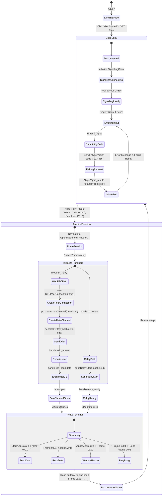

# Web Application Analysis: Skyping Web Client

## 1. Overview & Technology Stack

The Skyping web interface (`https://skyping.app/`) serves dual roles:
1. **Marketing Landing Page** (`/`): Introduces the product, displays install instructions, and links to `/app`.
2. **Web Terminal Client** (`/app` and `/app/[machineId]`): The interactive pairing and terminal session viewer.

### Recovered Architecture & Dependencies
From HTTP response headers and Next.js Turbopack chunk inspection, the web stack consists of:
- **Framework**: Next.js 16 (App Router, Turbopack, React 19).
- **Deployment Platform**: Cloudflare Workers / Pages via OpenNext (`x-opennext: 1`, `x-powered-by: Next.js`, Cloudflare edge).
- **Terminal Rendering**: `@xterm/xterm` (v5+) with DOM/Canvas renderers and fit addon.
- **Styling**: Tailwind CSS v4, Inter font, JetBrains Mono, Bricolage Grotesque.
- **Analytics / Telemetry**: PostHog Web (`us.i.posthog.com`) and Google Tag Manager (`G-B41JZCRBJ6`).

---

## 2. Web Application Routes & Lifecycle



---

## 3. Deep Dive: Client-Side Components

### 3.1 Signaling Client (`SignalingClient`)
*Recovered from chunk `014jz~zg-c7-0.js` and `0m7._ckq5xyru.js` (module `35679`)*

```typescript
class SignalingClient {
  private serverURL: string;
  private ws: WebSocket | null = null;
  private browserId: string = crypto.randomUUID();
  private listeners: Set<(event: SignalingEvent) => void> = new Set();
  private heartbeatTimer: number | null = null;
  private reconnectTimer: number | null = null;
  private reconnectAttempt: number = 0;
  private intentionalClose: boolean = false;

  constructor(serverURL: string) {
    this.serverURL = serverURL;
  }

  connect(): void {
    this.intentionalClose = false;
    const url = `${this.serverURL}?role=browser&id=${this.browserId}`;
    this.ws = new WebSocket(url);
    
    this.ws.onopen = () => {
      this.reconnectAttempt = 0;
      this.startHeartbeat();
      this.emit({ type: "connected" });
    };

    this.ws.onmessage = (event: MessageEvent) => {
      try {
        const msg = JSON.parse(typeof event.data === "string" ? event.data : "");
        this.handleMessage(msg);
      } catch (err) {
        // Ignored
      }
    };

    this.ws.onclose = () => {
      this.cleanup();
      this.emit({ type: "disconnected" });
      if (!this.intentionalClose) {
        this.scheduleReconnect();
      }
    };

    this.ws.onerror = () => {
      this.ws?.close();
    };
  }

  private scheduleReconnect(): void {
    // Exponential backoff capped at 30 seconds
    const delay = Math.min(1000 * Math.pow(2, this.reconnectAttempt), 30000);
    this.reconnectAttempt++;
    this.reconnectTimer = setTimeout(() => this.connect(), delay);
  }

  private startHeartbeat(): void {
    this.stopHeartbeat();
    this.heartbeatTimer = setInterval(() => this.sendHeartbeat(), 20000); // 20s interval
  }

  join(code: string): void {
    this.send({ type: "join", code });
  }

  sendSDPOffer(machineId: string, sdp: RTCSessionDescriptionInit): void {
    this.send({ type: "sdp_offer", machineId, sdp });
  }

  sendICECandidate(targetId: string, candidate: RTCIceCandidateInit): void {
    this.send({ type: "ice_candidate", targetId, candidate });
  }

  sendRelayStart(machineId: string): void {
    this.send({ type: "relay_start", machineId });
  }

  sendRelayData(targetId: string, data: string): void {
    this.send({ type: "relay_data", targetId, data });
  }
}
```

### 3.2 Binary Framing Protocol
*Recovered from chunk `00cwqo-rg0i_3.js` (module `43322`)*

Terminal traffic does not pass as raw JSON or plain strings. Skyping defines an explicit binary protocol using a 1-byte header:

| Opcode | Name | Binary Layout | Description |
| :---: | :--- | :--- | :--- |
| `0x01` | **DATA** | `[0x01, ...utf8_bytes]` | Keystroke input (client $\to$ host) or terminal output (host $\to$ client). |
| `0x02` | **RESIZE** | `[0x02, cols_hi, cols_lo, rows_hi, rows_lo]` | 5-byte payload: Byte 0 is `0x02`, followed by big-endian 16-bit uints for columns and rows. |
| `0x03` | **CLOSE** | `[0x03, ...reason_utf8]` | Clean disconnect signal containing UTF-8 reason string. |
| `0x04` | **PING** | `[0x04]` | 1-byte keep-alive ping. |
| `0x05` | **PONG** | `[0x05]` | 1-byte keep-alive pong. |

```typescript
// Framing implementation extracted from client:
function encodeDataFrame(data: string | Uint8Array): ArrayBuffer {
  const bytes = typeof data === "string" ? new TextEncoder().encode(data) : data;
  const buffer = new ArrayBuffer(1 + bytes.byteLength);
  const view = new Uint8Array(buffer);
  view[0] = 0x01;
  view.set(bytes, 1);
  return buffer;
}

function encodeResizeFrame(cols: number, rows: number): ArrayBuffer {
  const buffer = new ArrayBuffer(5);
  const view = new DataView(buffer);
  view.setUint8(0, 0x02);
  view.setUint16(1, cols, false); // Big-endian
  view.setUint16(3, rows, false); // Big-endian
  return buffer;
}

function decodeFrame(buffer: ArrayBuffer): DecodedFrame {
  const view = new Uint8Array(buffer);
  if (view.length === 0) throw new Error("empty frame");
  const type = view[0];
  switch (type) {
    case 0x01:
      return { type: 1, data: view.slice(1) };
    case 0x02: {
      if (view.length < 5) throw new Error("resize frame too short");
      const dv = new DataView(buffer);
      return { type: 2, cols: dv.getUint16(1, false), rows: dv.getUint16(3, false) };
    }
    case 0x03:
      return { type: 3, reason: new TextDecoder().decode(view.slice(1)) };
    case 0x04:
    case 0x05:
      return { type };
    default:
      throw new Error(`unknown frame type: 0x${type.toString(16)}`);
  }
}
```

### 3.3 WebRTC PeerSession & Flow Control
*Recovered from chunk `00cwqo-rg0i_3.js`*

1. **ICE Servers**: Hardcoded to `stun:stun.l.google.com:19302`.
2. **DataChannel Name**: `"terminal"`, configured as `{ ordered: true }`, `binaryType: "arraybuffer"`.
3. **Backpressure Handling**:
   - Skyping monitors `dc.bufferedAmount`.
   - If `dc.bufferedAmount > 1,048,576` bytes (1 MiB), transmission is suspended.
   - It assigns `dc.bufferedAmountLowThreshold = 524,288` (512 KiB) and waits for `dc.onbufferedamountlow` before resuming input delivery.

---

## 4. Architectural Evaluation for Shellvyn

| Observation | Skyping Implementation | Shellvyn Recommendation |
| :--- | :--- | :--- |
| **STUN/TURN Infrastructure** | Only public Google STUN (`stun.l.google.com:19302`); zero TURN servers. | Must supply TURN servers (via coturn or Cloudflare Calls) to avoid relying exclusively on an unencrypted WebSocket relay. |
| **Relay Security** | In relay mode, data is base64 encoded and sent unencrypted to the signaling server. | Shellvyn **must enforce End-to-End Encryption (E2EE)** using AES-GCM or ChaCha20-Poly1305 over both WebRTC and Relay transports. |
| **Terminal Customization** | Hardcoded dark background `#111612`, fixed font size. | Provide customizable themes (Catppuccin, Tokyo Night, Monokai), configurable font sizes, and full-screen toggle. |
| **Clipboard & Keybindings** | Standard browser paste, bracketed paste mode enabled. | Implement native clipboard read/write permission handling and shortcut modifiers (`Ctrl+Shift+V`, `Cmd+V`). |
